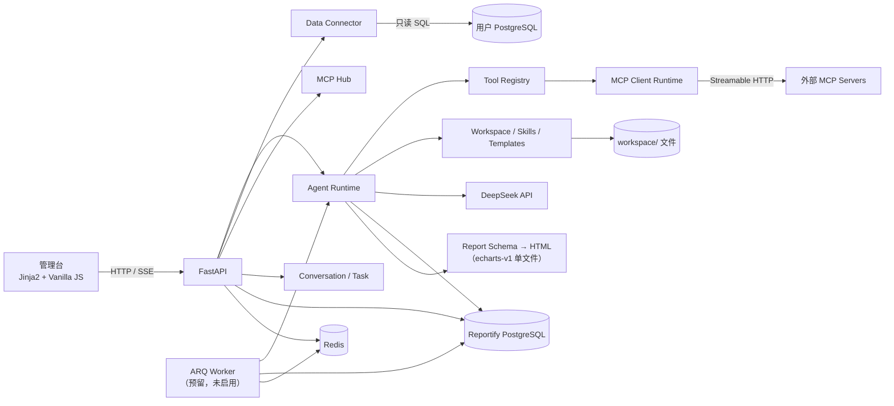
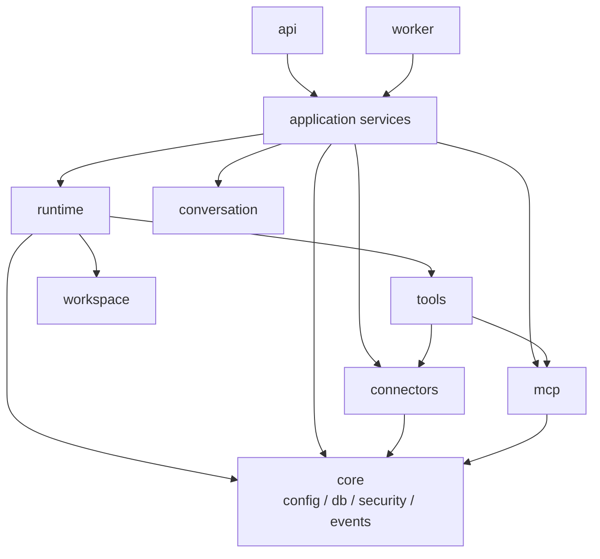
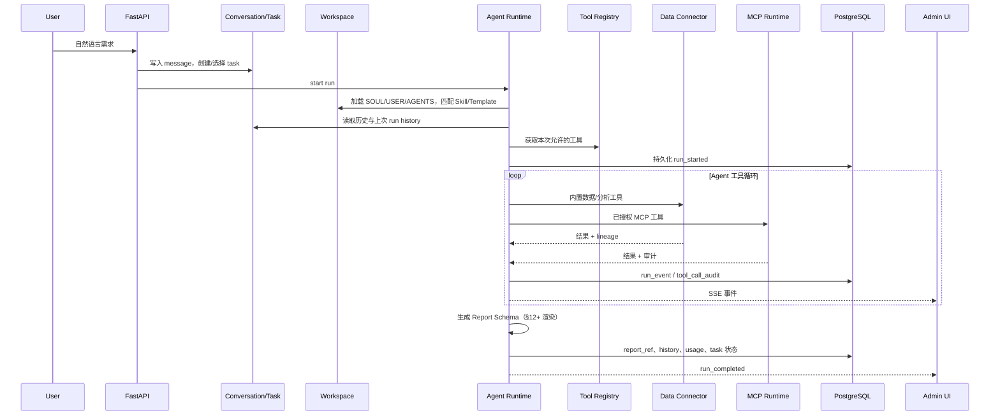

# 01 · 系统总览

> 范围：Reportify V3 的模块边界、部署形态、端到端数据流与 MVP 边界。  
> 本次只设计 `prompt.md` §1–§11 已有章节；§12+ 只给最小接口契约。

---

## 1. Purpose

用一份总览把 17 个模块放回同一张图：谁负责理解、谁负责计算、谁负责取证、谁负责展示，以及它们之间的依赖方向。后续各专题文档都以本文的边界为准。

**成功标准**：

- 任一功能需求都能被路由到唯一主责模块。
- 模块间依赖方向清晰，不存在双向耦合。
- 部署形态与本地优先目标一致，不为未来规模预付复杂度。

---

## 2. Non-Goals

- 不设计多租户、RBAC、微服务拆分。
- 不设计 Context 压缩的内部实现（§12+）；Memory、Report Revision、Scheduler 已由 M8–M10 实现。
- 不规定前端框架；管理台保持服务端渲染 + 原生 JavaScript。
- 不承诺高可用集群部署；MVP 面向单机与小团队。

---

## 3. 设计原则

| 原则 | 含义 | 反例 |
| --- | --- | --- |
| LLM 理解，Python 计算 | LLM 负责意图、规划、选工具、解释；数值与统计由确定性代码完成 | 让 LLM 心算同比、方差或生成 SQL 直接执行 |
| Schema 是硬协议 | Agent 只能输出经 Pydantic 校验的结构化结果 | LLM 直接生成 HTML/JS |
| 可追溯 | 指标、图表、结论都能回到 SQL/工具、参数、样本量与口径 | 只保存最终文本 |
| 默认只读、默认拒绝 | 数据源只读；工具未授权不可见；写操作需显式确认 | 接入 MCP 即全权授权 |
| 文件化配置 | 角色、偏好、执行规范、Skills、模板以文件为源 | 全部塞进 Prompt 或数据库 |
| 本地优先 | 单机可跑，Redis/PG 由 Docker 提供 | 先上消息总线与微服务 |
| 渐进式加载 | Skills、工具、上下文按需加载 | 一次性把所有内容塞进上下文 |

---

## 4. 17 个模块与本次范围

| # | 模块 | 本次状态 | 说明 |
| --- | --- | --- | --- |
| 1 | Data Connector | **详细设计** | PostgreSQL 只读接入、结构发现、安全查询、分页、快照 |
| 2 | MCP Hub | **详细设计** | Server 配置、测试、发现、启停、工具授权 |
| 3 | MCP Client Runtime | **详细设计** | Streamable HTTP 连接、工具发现/调用、超时、审计 |
| 4 | Tool Registry | **详细设计** | 内置/MCP 工具统一注册、过滤、授权、审计绑定 |
| 5 | Agent Workspace | **详细设计** | SOUL / USER / AGENTS 加载与优先级 |
| 6 | Skills Manager | **详细设计** | 索引、匹配、渐进加载 |
| 7 | Conversation Management | **详细设计** | 会话、消息、事件持久化 |
| 8 | Memory Management | **已实现（M10）** | `memory` 表 + 词面召回注入；无向量库 |
| 9 | Context Management | **最小接口** | 只定义 `ContextAssembler` 契约，压缩策略 §12+ |
| 10 | Analysis Task Management | **详细设计** | 任务状态、多任务、恢复 |
| 11 | Agent Runtime | **详细设计** | PydanticAI 编排、工具循环、限制、事件 |
| 12 | Data Profiling | **最小契约** | 工具输入/输出与 lineage；实现 §12+ |
| 13 | Analysis Engine | **最小契约** | 工具输入/输出与 lineage；算法 §12+ |
| 14 | Report Engine | **最小契约** | Report Schema 与渲染边界；实现 §12+ |
| 15 | Report Revision | **已实现（M9）** | `report_ref.version` / `parent_report_id` / `schema`；版本链与结构化 diff |
| 16 | Scheduler | **已实现（M8）** | `schedule` 表 + 进程内 tick，`FOR UPDATE SKIP LOCKED` 认领；ARQ 未启用（D-08） |
| 17 | Observability | **接口** | OTel 埋点与事件字段；后端可替换 |

---

## 5. 容器与部署拓扑

**部署形态**：

| 组件 | 形态 | 说明 |
| --- | --- | --- |
| `api` | FastAPI + Uvicorn | 管理台、API、交互式 run、SSE 与调度 tick |
| `worker` | ARQ Worker（预留） | 尚未启用；定时触发目前由 API 进程内 tick 承担（D-08） |
| `postgres` | 单实例 | 系统元数据、会话、任务、审计 |
| `redis` | 单实例 | 队列、事件 fan-out、短期缓存 |
| `workspace` | 挂载卷 | 配置文件、Skills、模板、报告产物 |
| 外部依赖 | DeepSeek API、用户数据库、MCP Server | 均通过受控适配器访问 |

单机 Docker Compose 即可；Kubernetes、消息总线、外部对象存储不在 MVP。

---

## 6. 模块依赖规则

规则：

1. `api` 只做协议转换与鉴权，不写业务规则。
2. 领域模块之间只通过接口（Protocol / 服务类）协作，不导入对方内部实现。
3. `runtime` 依赖抽象：`ToolRegistry`、`DataConnector`、`WorkspaceLoader`，由应用层注入。
4. `tools` 是唯一同时接触 Connector 与 MCP 的模块；Runtime 不直接调用它们。
5. `core` 不依赖任何领域模块。
6. 禁止双向依赖；发现循环依赖时，先抽接口，不加中间层。

---

## 7. 端到端数据流

关键约束：

- 报告引用的每个数字必须有 `dataset_snapshot` 或工具结果作为来源。
- 工具调用审计与事件写入失败时，优先保证审计完整，不静默继续。
- UI 只消费事件与状态，不参与计算。

---

## 8. 关键决策摘要

| ID | 决策 | 结论 |
| --- | --- | --- |
| D-01 | 交互式执行拓扑 | FastAPI 进程内执行 + SSE；ARQ 只跑定时/长任务 |
| D-02 | Agent 编排 | 单 Agent + 工具循环；计划是结构化事件与 Task 字段 |
| D-03 | 工具授权 | 请求前过滤 + 写操作审批 + 执行前二次校验 |
| D-04 | MCP 连接 | Agent 面 per-run 懒连接；管理面短连接 |
| D-05 | 会话持久化 | 应用消息表 + PydanticAI `ModelMessage` JSON |
| D-06 | Workspace | 文件为源，DB 只存索引与审计 |
| D-07 | 报告契约 | 只定义 Template → Report Schema 与 lineage |
| D-08 | 定时触发载体 | 进程内 asyncio tick + `schedule` 行锁（`SKIP LOCKED`），多实例仍不重复；ARQ 仅作扩展预留 |

---

## 9. 非功能要求

| 维度 | 目标 | 设计落点 |
| --- | --- | --- |
| 性能 | 单次查询 ≤30s；交互式 run ≤10min；数据 ≤100 万行 | Connector 超时/行数限制；Runtime 超时 |
| 可靠性 | run 可取消、可重试；进程崩溃后可判定状态 | `task_run` / `run_event` 持久化；幂等键 |
| 安全 | 默认只读；默认拒绝；凭证加密；SSRF 防护 | Connector、Tool Registry、MCP、Secret |
| 可观测 | 每次 run 可按 `run_id` 追踪 | 结构化日志 + OTel span + `run_event` |
| 可维护 | 模块边界稳定；文档与代码同源 | 本文依赖规则 + 各专题文档 |

---

## 10. MVP 边界

**包含**：

- PostgreSQL 只读 Connector 与元数据/标签。
- 内置数据与分析工具的最小契约。
- 单 Agent Runtime、会话、多任务、SSE 执行过程。
- Streamable HTTP MCP、工具授权与审计。
- Workspace / Skills / Templates 文件化加载。
- 定时任务：`schedule` 表、Cron 解析、tick 派发与 `/schedules` API。
- 长期记忆：`memory` 表与词面召回注入（`plan.memory_used` 可追溯）。
- 5 个既有视图 + MCP / Skills / Templates 3 个配置视图。

**不包含**：

- 上下文自动压缩、报告版本回滚/分支、ARQ 队列与通知渠道（§12+）。
- 脚本沙箱、多数据源 Connector、多用户与 RBAC。
- 报告内追问、在线筛选、下钻。

---

## 11. Failure Modes

| 场景 | 影响 | 处理 |
| --- | --- | --- |
| DeepSeek 限流/过载 | run 中断 | 指数退避重试；超限失败并保留进度 |
| 用户数据库超时 | 工具失败 | 语句超时 + 行数上限；返回可解释错误 |
| MCP Server 不可达 | 部分工具不可用 | 连接测试失败；run 继续使用内置工具 |
| 进程崩溃 | run 状态不明 | 启动时扫描 `running` 超时项，标记失败或可重试 |
| 报告渲染失败 | 无报告产物 | `report_ref.status=failed`，保留 lineage |

---

## 12. Open Questions

1. 单用户模式下是否需要 `REPORTIFY_AUTH_TOKEN`？默认只监听 `127.0.0.1` 是否足够？
2. 报告 HTML 默认写入独立 `reports_dir`（`09-engineering.md`）；具体默认路径与备份策略仍需确认。
3. 定时任务配置是否复用 `analysis_task`，还是建立独立 `schedule` 实体（§12+）？
4. 是否需要为 DeepSeek 之外的模型保留 Provider 切换点？当前只做配置化，不做抽象层。
