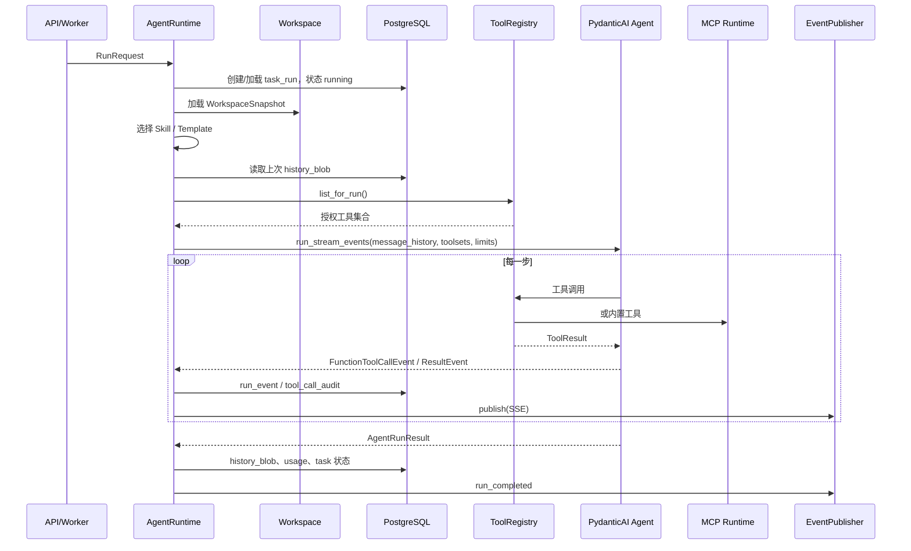

# 02 · Agent Runtime

> 依赖：`08-data-model.md`、`03-tooling-and-mcp.md`、`06-workspace-skills-templates.md`。  
> 基线：PydanticAI **v2**（核查版本 2.71.0）。

---

## 1. Purpose

定义一次 `AnalysisTask` 从接收到产出报告的执行链路：上下文如何装配、Agent 如何构造、工具如何暴露、执行如何受限、事件如何持久化、失败如何收敛。

Runtime 是**编排者**，不是计算者：它不实现统计、不生成 HTML、不管理连接细节，只负责调用正确的能力并保证过程可追溯、可恢复、可审计。

---

## 2. Non-Goals

- 不设计 Memory 检索与上下文压缩算法（§12+），只保留接口。
- 不设计 Analysis Engine / Report Engine 内部实现，只依赖其工具契约。
- 不设计定时任务配置（§12+），只支持被 ARQ 触发。
- 不实现多 Agent 协作、规划器/执行器双阶段架构。

---

## 3. Responsibilities

| 职责 | 说明 |
| --- | --- |
| 读取请求 | 会话、任务、用户消息、触发来源、显式 Skill/Template |
| 装配上下文 | Workspace 配置、历史消息、上次 run 历史、任务目标 |
| 选择能力 | 匹配 Skill、选择 Template、获取授权工具 |
| 执行循环 | 调用 PydanticAI Agent，处理工具调用与输出 |
| 控制预算 | 请求数、工具数、token、成本、时长、循环检测 |
| 持久化 | `run_event`、`task_run`、`message`、`tool_call_audit` |
| 推送状态 | SSE 事件、任务状态、审批请求 |
| 错误收敛 | 分类、重试、降级、取消、超时 |

---

## 4. 依赖与契约

```python
@dataclass
class RuntimeDeps:
    session: AsyncSession              # 本次 run 的 DB 会话
    run_id: UUID
    task: AnalysisTask
    workspace: WorkspaceSnapshot       # SOUL/USER/AGENTS + skill index + template index
    registry: ToolRegistry             # 工具过滤与授权
    connectors: ConnectorRegistry      # 数据访问
    mcp: MCPHubClient                  # MCP 连接与调用
    events: EventPublisher             # 事件持久化 + SSE fan-out
    clock: Clock                       # 可测试时间源
```

Runtime 只依赖上述抽象；具体实现由应用层注入。任何模块都不得反向依赖 Runtime。

---

## 5. Agent 构造

```python
def build_agent(cfg: RuntimeConfig) -> Agent[RuntimeDeps, str]:
    model = OpenAIChatModel(
        cfg.model_name,                              # deepseek-flash
        provider=DeepSeekProvider(api_key=cfg.api_key),
    )
    return Agent(
        model,
        deps_type=RuntimeDeps,
        output_type=str,                             # 报告阶段按 run 覆盖为 ReportSchema
        instructions=assemble_instructions,          # callable(ctx) -> str
        retries={"output": 2, "tools": 1},
        tools=BUILTIN_TOOL_FUNCTIONS,                # 无状态内置工具
        max_concurrency=cfg.max_concurrency,
        tool_timeout=cfg.tool_timeout,
        end_strategy="graceful",
        capabilities=[Instrumentation(settings=cfg.instrumentation)],
    )
```

要点：

- **单例 Agent**：同一实例可并发 `run`；模型名、重试、并发上限由配置决定。
- **每 run 覆盖**：`output_type`、`toolsets`、`message_history`、`usage_limits`、`timeout`、`cancellation_token` 通过 `run_*` 参数传入。
- **模型接入**：使用 `OpenAIChatModel` + `DeepSeekProvider`；不要使用已改名的 `OpenAIModel`。
- **DeepSeek thinking**：默认开启。生成结构化报告时可传 `OpenAIChatModelSettings(thinking=False)`，避免 `tool_choice` 限制与推理开销。
- **结构化输出**：默认 Tool Output；不使用 `NativeOutput`（Chat Completions 不支持）。`output_validator` 中用 `ModelRetry` 修正，禁止静默接受。

---

## 6. 指令装配与优先级

`assemble_instructions(ctx)` 按固定顺序拼接，后者不得覆盖前者的安全约束：

| 优先级 | 来源 | 内容 |
| --- | --- | --- |
| 1 | 平台不变量（代码） | 不得编造数据；必须使用工具取证；不得生成可执行代码；工具授权规则 |
| 2 | `AGENTS.md` | 工作区执行规范：必须走 Python 工具、指标必须有口径、报告必须有来源 |
| 3 | `SOUL.md` | 角色与表达风格：专业、简洁、区分事实与推测 |
| 4 | `USER.md` | 长期偏好：语言、图表偏好、结论长度 |
| 5 | Task | 当前分析目标、数据源引用、显式 Skill/Template |
| 6 | Skill | 已匹配 Skill 的分析步骤与规则（完整内容按需加载） |
| 7 | Template | 报告结构摘要（章节、KPI 规则、图表偏好） |

规则：

- 平台不变量是**只读**的，任何文件都不能覆盖。
- `AGENTS.md` 只写执行规范，不写人格；`SOUL.md` 只写身份与风格；`USER.md` 只写偏好。重复内容在加载时告警。
- Skill 索引（名称 + 描述 + 适用场景）常驻；完整 `SKILL.md` 由 `load_skill` 工具按需加载，避免一次性塞满上下文。
- 指令总长度设上限（默认 8k tokens）；超出时优先裁剪 USER/Template 摘要，不裁剪安全规则。

---

## 7. Run 生命周期



### 7.1 步骤契约

| 步骤 | 输入 | 输出 | 失败处理 |
| --- | --- | --- | --- |
| 1. 接收 | `RunRequest` | `task_run` | 参数非法 → 400 |
| 2. 并发占位 | conversation_id | PG advisory lock | 已有运行 → 409 |
| 3. 加载配置 | workspace 路径 | `WorkspaceSnapshot` | 校验失败 → 任务失败 |
| 4. 选择能力 | 显式参数 + 索引 | skill/template | 未匹配 → 使用默认 |
| 5. 装配上下文 | task + history | `message_history` | 历史损坏 → 重建 |
| 6. 暴露工具 | task + grants | toolsets | 无工具 → 继续（可能无解） |
| 7. 执行 | Agent + limits | 事件流 | 见 §9 |
| 8. 收尾 | result | 持久化 + 状态 | 审计优先 |

### 7.2 RunRequest

```python
@dataclass(frozen=True)
class RunRequest:
    conversation_id: UUID
    task_id: UUID | None
    user_message_id: UUID
    trigger: Literal["interactive", "scheduled", "api"]
    skill_names: tuple[str, ...] = ()
    template_name: str | None = None
    model_overrides: dict[str, Any] = field(default_factory=dict)
    idempotency_key: str | None = None
```

`idempotency_key` 用于定时任务重复触发：相同 key 已成功则直接返回原 `run_id`。

---

## 8. 上下文装配（最小契约）

```python
class ContextAssembler:
    async def build(self, task: AnalysisTask, conversation_id: UUID,
                    workspace: WorkspaceSnapshot) -> ContextBundle: ...
```

`ContextBundle` 包含：

- `instructions: str`（§6）。
- `message_history: list[ModelMessage]`。
- `skill_index: list[SkillMeta]`（注入指令，不注入全文）。
- `template_summary: str | None`。

装配规则：

1. 优先使用该 Task 最近一次成功 run 的 `history_blob`；无则从 `message` 重建。
2. 重建时只保留 `user` / `assistant` 文本与工具结果摘要；工具调用细节从 `run_event` 引用。
3. 历史必须经 `sanitize_messages()` 后再使用；来自 UI 的内容视为不可信。
4. DeepSeek 思考模式要求：历史中的 `reasoning_content` 必须原样回传；不得重写或裁剪单条消息内部字段。
5. Token 预算：默认占模型窗口 60%；超限时按「最旧工具结果 → 最旧助手消息 → 最旧用户消息」顺序裁剪，**不裁剪**平台不变量、当前目标、最近一次计划与最新工具结果。
6. Memory 检索接口（§12+）：

```python
class MemoryProvider(Protocol):
    async def search(self, query: str, limit: int = 5) -> list[MemoryItem]: ...
```

MVP 返回空列表；调用点预留，不改变主链路。

---

## 9. 执行控制

### 9.1 默认预算

| 限制 | 交互式 | 定时任务 | 说明 |
| --- | --- | --- | --- |
| `request_limit` | 40 | 80 | 模型请求轮次 |
| `tool_calls_limit` | 25 | 60 | 工具调用总数 |
| `total_tokens_limit` | 300k | 600k | 输入 + 输出 |
| `cost_limit` | 可选 | 可选 | 按配置的单价计算 |
| `timeout` | 15 min | 45 min | 超时抛 `RunTimedOut` |
| 并发 | 4 | 2 | 全局信号量 |
| 单会话并发 | 1 | 1 | PG advisory lock |

### 9.2 循环检测

- 记录 `(tool_name, normalized_args)` 的调用指纹。
- 相同指纹连续 2 次且结果相同 → 以 `ModelRetry` 提示换策略。
- 相同指纹累计 3 次 → 以 `ToolFailed` 终止该工具，并在事件中记录 `loop_detected`。
- 同一 run 内 `generate_report` 最多 1 次；重复调用直接拒绝。

### 9.3 取消与超时

| 触发 | 机制 | 结果 |
| --- | --- | --- |
| 用户取消 | `CancellationToken.cancel()` | `RunCancelled`，保存部分历史，状态 `cancelled` |
| 工具内取消 | `ctx.cancel()` | 同上 |
| 超时 | `run(timeout=...)` | `RunTimedOut`，状态 `timed_out` |
| 进程退出 | 不调用 | 启动时扫描超时 `running` 记录，标记 `failed` |

取消后保留 `e.all_messages()` 中已完成的部分，允许用户从该点继续新 run。

### 9.4 模型错误与重试

| 异常 | 处理 |
| --- | --- |
| `ModelRateLimitError` | 读取 `Retry-After`，指数退避，最多 3 次 |
| `ModelOverloadedError` / 5xx | 指数退避，最多 3 次 |
| `ModelAuthenticationError` / `ModelQuotaExceededError` | 快速失败，提示配置问题 |
| `ModelContextWindowExceededError` | 裁剪上下文后重试 1 次；仍失败则终止 |
| `OutputTokenLimitExceeded` | 提高 `max_tokens` 或缩小输出范围后重试 1 次 |
| `UnexpectedModelBehavior` | 终止，保留事件与历史 |
| `UsageLimitExceeded` | 终止，状态 `failed`，附预算说明 |

---

## 10. 工具暴露与授权

Runtime 不直接管理 MCP 连接，只消费 `ToolRegistry` 的产物：

```python
builtin_ts = FunctionToolset(tools=registry.builtin_functions())
mcp_toolsets = [
    MCPToolset(
        server.url,
        id=f"mcp_{server.slug}",
        headers=server.non_secret_headers,
        auth=server.auth_provider,
        read_timeout=server.read_timeout,
        tool_error_behavior="retry",
        cache_tools=True,
        include_instructions=False,
    ).filtered(lambda ctx, td: registry.is_authorized(server.id, td.name, ctx.deps))
    .approval_required(lambda ctx, td, args: registry.requires_approval(server.id, td.name))
    for server in registry.enabled_servers()
]
```

三层防护：

1. **隐藏**：未授权工具不进入 toolsets，模型看不到。
2. **审批**：写/破坏性工具通过 `.approval_required()` 触发 `DeferredToolRequests`，任务进入 `waiting_approval`。
3. **二次校验**：工具包装器在执行前调用 `registry.authorize()`；拒绝则抛 `ToolFailed`。

命名映射：数据库使用 `mcp.<server>.<tool>`；模型侧使用 `mcp_<server>_<tool>`（PydanticAI 工具名限制）；映射由 Registry 维护。

---

## 11. 事件模型

统一由 `EventPublisher` 写入 `run_event` 并推送 SSE。

| PydanticAI 事件 | 应用事件 | 载荷 |
| --- | --- | --- |
| run 开始 | `run_started` | model、limits、task_id |
| 分析计划生成 | `plan` | 步骤、工具、预期产物 |
| 模型请求完成 | `model_request` | usage、finish_reason |
| 用量更新 | `usage` | 请求数、工具数、token、成本 |
| `FunctionToolCallEvent` | `tool_call` | tool_call_id、tool_name、args_redacted |
| `FunctionToolResultEvent` | `tool_result` | status、duration_ms、summary |
| `OutputToolCallEvent` | `report_generated` 的前置 | schema 摘要 |
| `OutputToolResultEvent` | `report_generated` | report_ref_id |
| 审批挂起 | `approval_required` | tool_name、args_redacted、risk |
| `AgentRunResultEvent` | `run_completed` | output 摘要、usage |
| 异常 | `error` | code、message、retryable |

事件写入规则：

- 每个事件分配 `(run_id, sequence)`，先写 DB 再推送；推送失败不影响执行。
- 工具参数必须脱敏后入事件；完整结果不落事件表。
- SSE 断线可通过 `run_event` 重放（按 `sequence`）。

---

## 12. 持久化与恢复

| 时点 | 写入 |
| --- | --- |
| run 开始 | `task_run`（running）、`run_event(run_started)` |
| 每次模型响应 | `run_event(model_request)`、`task_run.usage` |
| 每次工具调用 | `tool_call_audit`、`run_event(tool_call/tool_result)` |
| 输出校验通过 | `message(assistant)`、`report_ref`、`run_event(report_generated)` |
| run 结束 | `task_run.history_blob`、`usage`、`status`、`finished_at` |
| 取消/超时 | 部分历史、状态、`run_event(error)` |

恢复策略：

- **MVP 不支持 run 中途恢复**。崩溃后该 run 标记失败，用户可基于上一次成功历史重试。
- 历史反序列化失败时，回退到 `message` 重建，并记录 `workspace_audit` 或 `run_event` 告警。
- 幂等：相同 `idempotency_key` 的定时 run 已成功则直接返回。

---

## 13. 并发与隔离

- 全局并发由 `max_concurrency` + 应用信号量双重限制。
- 同一 Conversation 同时只允许一个活跃 run；用 PostgreSQL advisory lock（`pg_try_advisory_lock`）实现，进程重启后自动释放。
- 不同 Conversation 可并发；MCP 连接按 run 创建，不共享 session。
- Agent 单例并发安全；`RuntimeDeps` 每次 run 独立，禁止跨 run 复用可变状态。

---

## 14. 可观测性

- OTel span：`run`、`model_request`、`tool_call`；属性包含 `run_id`、`task_id`、`tool_name`、`status`、`duration_ms`。
- 结构化日志字段：`run_id`、`task_id`、`conversation_id`、`tool_name`、`event_type`、`error_code`。
- 不在日志中输出 Prompt 全文、工具参数原文或凭证。
- Langfuse 通过 OTLP 接入属于可选部署项；未验证前不作为依赖。

---

## 15. Failure Modes

| 场景 | 表现 | 处理 |
| --- | --- | --- |
| 无可用工具 | Agent 只能空谈 | 指令中明确「无工具时说明限制」；事件告警 |
| 工具全部失败 | 循环重试 | 循环检测 + 预算上限 |
| 输出校验失败 | `UnexpectedModelBehavior` | 保留最后一次输出摘要；提示用户缩小范围 |
| 审批无人处理 | run 挂起 | 任务 `waiting_approval`；超时自动取消 |
| 历史过大 | 上下文超限 | 裁剪后重试；仍失败则新建任务 |
| DeepSeek 返回空 JSON | content 全空格 | 视为校验失败并重试，不当作成功 |
| SSE 客户端断开 | UI 无实时事件 | 不影响执行；重连后按 sequence 重放 |

---

## 16. Open Questions

1. 审批恢复是否在 MVP 实现，还是先只做「拒绝写工具」？
2. Skill 自动匹配采用关键词还是让 Agent 自行选择？当前设计：索引注入 + `load_skill` 工具。
3. 历史 blob 按 run 全量保存的存储增长是否需要更早引入压缩？
4. 交互式 run 是否需要支持「暂停后继续」，还是只支持取消后重跑？
