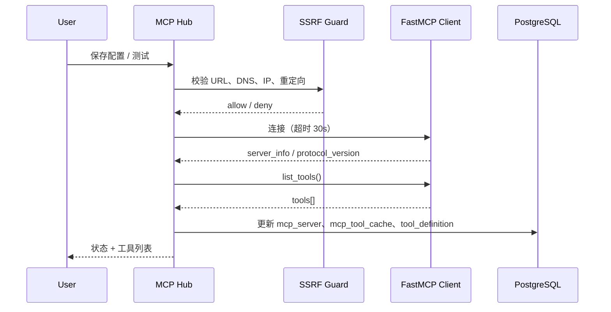
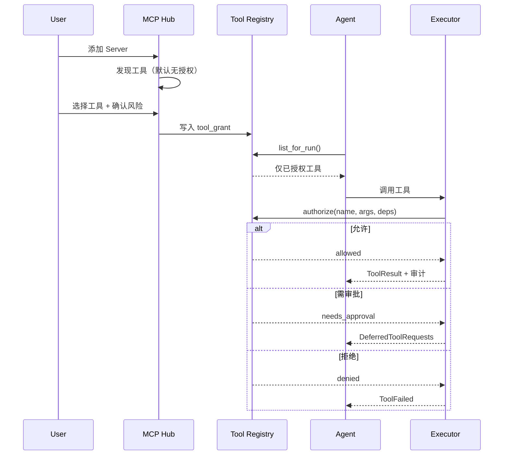

# 03 · Tool Registry 与 MCP

> 依赖：`08-data-model.md`。  
> 基线：MCP Python SDK v2.3.0（协议 2026-07-28）；PydanticAI v2 `MCPToolset`（底层 FastMCP）。

---

## 1. Purpose

把「内置工具、数据接口、外部 MCP 工具」收敛到**一个注册表、一套授权、一条审计链**。Agent 只看到当前任务允许使用的工具，不直接管理任何连接。

---

## 2. Non-Goals

- 不实现 MCP 协议；使用成熟客户端。
- 不在服务端硬编码 GitHub / Jira / Sentry 等具体 Server。
- 不实现 stdio 任意命令执行；MVP 只支持 Streamable HTTP。
- 不把工具名或描述当作权限依据。

---

## 3. 工具分类与命名

| 类别 | 示例 | 来源 | 默认风险 |
| --- | --- | --- | --- |
| `builtin_data` | `inspect_dataset`、`profile_dataset`、`query_dataset`、`fetch_dataset` | Reportify 代码 | `read` |
| `builtin_analysis` | `analyze_trend`、`analyze_distribution`、`compare_periods`、`detect_anomalies`、`analyze_correlation` | Reportify 代码（§12+ 实现） | `read` |
| `report` | `generate_report` | Reportify 代码（输出工具） | `write`（仅写本地报告） |
| `meta` | `load_skill` | Reportify 代码 | `read` |
| `mcp` | 任意 Server 暴露的工具 | 用户接入 | **`write`（保守默认）** |

**命名**：

- 数据库规范名：`builtin.query_dataset`、`mcp.github.search_issues`。
- 模型可见名：`query_dataset`、`mcp_github_search_issues`（PydanticAI 工具名限制）。
- 映射由 Registry 维护，禁止在 Prompt 中出现两种命名混用。

---

## 4. Tool Registry

### 4.1 职责

| 职责 | 说明 |
| --- | --- |
| 注册 | 内置工具启动时镜像到 `tool_definition`；MCP 工具发现后提升 |
| 描述 | 名称、描述、JSON Schema、来源、风险等级 |
| 过滤 | 按启用状态、授权、任务上下文生成可用集合 |
| 授权 | 全局/会话/任务三级 grant，默认拒绝 |
| 审批 | 判断是否需要人工确认 |
| 绑定 | 将工具名解析到内置函数或 MCP 调用 |
| 审计 | 统一写入 `tool_call_audit` |

### 4.2 接口

```python
class ToolRegistry:
    async def list_for_run(self, deps: RuntimeDeps) -> list[ToolSpec]: ...
    def resolve(self, name: str) -> ToolBinding: ...
    async def authorize(self, name: str, args: dict, deps: RuntimeDeps) -> AuthorizationDecision: ...
    def requires_approval(self, name: str, deps: RuntimeDeps) -> bool: ...
    def builtin_functions(self) -> list[Callable]: ...
    def enabled_servers(self) -> list[MCPServerConfig]: ...
```

`AuthorizationDecision`：

```python
@dataclass(frozen=True)
class AuthorizationDecision:
    allowed: bool
    reason: str                  # granted / denied / needs_approval / risk_unacknowledged
    effective_scope: Literal["task", "conversation", "global", "none"]
```

### 4.3 过滤规则

工具进入模型上下文必须同时满足：

1. `tool_definition.enabled = true`。
2. 所属 MCP Server 为 `enabled` 且 `status != error`。
3. 存在 `allowed=true` 的 grant（task > conversation > global）。
4. 风险等级允许：`read` 直接放行；`write` 需 `risk_acknowledged`；`destructive` 还需每次调用审批。
5. 未超过该 Server 的并发/速率限制。

---

## 5. 内置工具契约

> 只定义输入/输出与 lineage，不定义算法；算法属于 §12+。

| 工具 | 输入 | 输出 | 说明 |
| --- | --- | --- | --- |
| `inspect_dataset` | `data_source_id`, `schema?`, `table?` | `TableSchema[]` | 只读结构发现 |
| `profile_dataset` | `data_source_id`, `table`, `columns?`, `sample_size?` | `ProfileResult` | 类型、空值率、唯一值、分布摘要 |
| `query_dataset` | `data_source_id`, `QuerySpec` | `QueryResult` | 受限查询构造器；返回预览与 `snapshot_id` |
| `fetch_dataset` | `snapshot_id`, `offset`, `limit` | `Page` | 分页读取 |
| `analyze_trend` | `data_source_id`, `table`, `metric`, `time_column`, `granularity`, `range` | `AnalysisResult` | 趋势与波动 |
| `analyze_distribution` | `data_source_id`, `table`, `field`, `bins?` | `AnalysisResult` | 分布与偏度 |
| `compare_periods` | `data_source_id`, `table`, `metric`, `current`, `previous` | `AnalysisResult` | 周期对比 |
| `detect_anomalies` | `data_source_id`, `table`, `metric`, `method`, `threshold` | `AnalysisResult` | 异常检测 |
| `analyze_correlation` | `data_source_id`, `table`, `fields`, `method` | `AnalysisResult` | 相关性 |
| `load_skill` | `name` | `SkillContent` | 按需加载 Skill 全文 |
| `generate_report` | `ReportSchema` | `ReportRef` | 输出工具；Schema 校验后生成报告引用 |

**通用要求**：

- 任何工具都不得接受原始 SQL 字符串；查询通过 `QuerySpec` 构造。
- 每个结果必须包含 `lineage`：数据源、表、字段、时间范围、过滤条件、样本量、执行时间、口径说明。
- 工具返回给模型的内容只包含摘要与必要数据；完整结果留在 Python 侧供报告引用。

---

## 6. ToolResult 信封

```python
class Lineage(BaseModel):
    data_source_id: UUID
    table: str | None
    sql: str | None                 # 规范化后的只读 SQL
    params: dict[str, Any]          # 已脱敏
    time_range: tuple[datetime, datetime] | None
    filters: dict[str, Any]
    row_count: int | None
    snapshot_id: UUID | None
    executed_at: datetime
    duration_ms: int
    definition: str                 # 计算口径

class ToolResult(BaseModel):
    ok: bool
    summary: str                    # 给模型看的短文本
    data: dict[str, Any] | None     # 结构化摘要，不超过大小上限
    lineage: Lineage | None
    warnings: list[str] = []
    truncated: bool = False
    error: ToolError | None = None
```

规则：

- 序列化后上限 200 KB；超出时截断 `data`，置 `truncated=true`，`summary` 说明截断原因。
- 永不返回可执行 HTML/JS；文本按数据展示，不解释为指令。
- 失败时 `ok=false`，`error.code` 使用稳定枚举（`timeout`、`permission_denied`、`invalid_argument`、`upstream_error`、`not_found`）。

---

## 7. MCP Hub（管理面）

### 7.1 管理能力

| 能力 | 说明 |
| --- | --- |
| 添加/编辑/删除 Server | 名称、传输、URL、认证方式、凭证、超时 |
| 测试连接 | 校验 URL → SSRF 检查 → 连接 → 发现工具 → 持久化状态 |
| 启用/禁用 | 禁用后工具立即从所有 run 中消失 |
| 查看工具 | 名称、描述、参数 Schema、风险等级、授权状态 |
| 授权 | 按工具设置全局/会话/任务 grant 与风险确认 |
| 查看审计 | 按 Server、工具、时间、状态过滤 |

### 7.2 连接测试流程



### 7.3 工具发现与 Schema 漂移

- 发现结果写入 `mcp_tool_cache`，计算 `schema_hash`。
- 新工具默认 `risk_level=write`、无 grant；必须在 UI 中显式授权。
- Schema 变化时：更新 `cache_version`；写工具要求重新确认风险；读工具保留授权但记录事件。
- 缓存不是连接状态真相：每次测试/发现都重新拉取；运行前如发现缓存过期则刷新。

### 7.4 传输与认证

| 项 | MVP | 说明 |
| --- | --- | --- |
| Streamable HTTP | 支持 | 主路径 |
| SSE | 不新建 | 官方已不推荐 |
| stdio | 禁用 | 需命令白名单、环境隔离、沙箱后才可考虑 |
| 无认证 | 支持 | 仅限本地/可信网络 |
| Bearer Token | 支持 | 存入 `secret` |
| OAuth 2.1 | 后续 | 依赖实际 SDK 能力；发现链路的 URL 必须做 SSRF 校验 |

---

## 8. MCP Client Runtime

### 8.1 两条连接平面

| 平面 | 使用方 | 实现 | 生命周期 |
| --- | --- | --- | --- |
| 管理面 | MCP Hub（测试、发现） | FastMCP Client（短连接） | 单次请求 |
| Agent 面 | PydanticAI `MCPToolset` | FastMCP Client（PydanticAI 内置） | 单次 run，懒连接 |

**决策**：MVP 统一使用 FastMCP 客户端栈（PydanticAI 的 MCP 集成即 FastMCP），避免同时维护官方 `mcp` SDK 与 FastMCP 两套连接。官方 `mcp` v2 SDK 保留为未来替换点，通过 `MCPClientFactory` 接口隔离。

### 8.2 Agent 面构造

```python
def build_mcp_toolset(server: MCPServerConfig, deps: RuntimeDeps) -> MCPToolset:
    return (
        MCPToolset(
            server.url,
            id=f"mcp_{server.slug}",
            headers=server.non_secret_headers,
            auth=server.auth_provider,
            read_timeout=server.read_timeout,     # 默认 60s
            tool_error_behavior="retry",          # 可重试错误回灌模型
            cache_tools=True,
            include_instructions=False,           # 不把 Server 指令当系统指令
        )
        .filtered(lambda ctx, td: deps.registry.is_authorized(server.id, td.name, ctx.deps))
        .approval_required(lambda ctx, td, args: deps.registry.requires_approval(td.name, ctx.deps))
    )
```

规则：

- 每个 run 新建 toolset；不跨 run 复用连接。
- 连接失败不阻塞整个 run：该 Server 的工具从本次工具集移除，事件记录 `mcp_unavailable`。
- `cache_tools=True` 依赖 `notifications/tools/list_changed`；若 Server 动态变更工具，测试后刷新缓存。
- 不启用 `include_instructions`；Server 指令与工具描述均视为不可信文本。

### 8.3 错误映射

| 上游情况 | 表现 | 处理 |
| --- | --- | --- |
| 超时 | `MCPError(-32001)` | 记为 `timeout`，可重试一次 |
| `ToolError` | `is_error=true`，内容进入 `content` | 作为可解释失败回灌模型 |
| `MCPError` | 客户端抛异常 | `ToolFailed`，不重试；记录审计 |
| 未知工具 | `is_error=true` | 缓存失效，触发重新发现 |
| 连接中断 | 传输异常 | 本次调用失败；Server 标记 `error` |
| 结果过大 | 超限 | 截断并提示；不把完整结果塞入上下文 |

---

## 9. 授权模型

### 9.1 默认策略

- 新 Server：`enabled=false` 或工具全部无 grant。
- MCP 工具：默认 `risk_level=write`，默认拒绝。
- 用户必须逐工具授权；不提供「一键全部授权」。
- `destructive` 每次调用都需要确认，不设永久授权。

### 9.2 授权流程



### 9.3 风险等级判定

| 等级 | 判定 | 示例 |
| --- | --- | --- |
| `read` | 内置只读工具；或用户显式标注的 MCP 只读工具 | 查询、统计、趋势 |
| `write` | MCP 默认；产生外部副作用或写入 | 创建工单、发消息 |
| `destructive` | 删除、覆盖、批量修改 | 删除记录、关闭实例 |

**禁止**根据工具名称或描述自动判定为 `read`。用户标注后仍需在审计中记录。

---

## 10. 审计

每次工具调用（含被拒绝）写入 `tool_call_audit`：

| 字段 | 内容 |
| --- | --- |
| `run_id` / `tool_name` / `source` | 定位 |
| `arguments_redacted` | 移除 token、密码、连接串、个人数据 |
| `result_summary` | 状态、行数、耗时、错误码；不存完整结果 |
| `status` | `allowed` / `denied` / `approved` / `rejected` / `succeeded` / `failed` / `timeout` |
| `error_code` | 稳定枚举 |
| `duration_ms` | 执行耗时 |

审计写入失败时，工具调用按失败处理；不允许「执行成功但无审计」。

---

## 11. 安全

### 11.1 凭证

- 统一存 `secret` 表，AES-GCM 加密；密钥来自环境变量，支持轮换。
- API/日志/审计只出现 `secret_id`，不出现明文。
- OAuth token bundle 视为一个 secret；刷新在连接层完成。

### 11.2 SSRF

MCP URL 与 OAuth 发现链路的每个 URL 都要校验：

1. scheme 仅 `https`（本地开发允许 `http://127.0.0.1`）。
2. 禁止 URL userinfo。
3. DNS 解析后检查 IP：拒绝私有网段、回环、链路本地、组播、云元数据地址（如 `169.254.169.254`）。
4. 限制重定向次数（≤3），每次重定向重新校验；禁止跨源重定向。
5. 对 `resource_metadata`、`authorization_servers`、`token_endpoint` 等发现 URL 应用同一套校验。
6. 连接超时与读取超时显式设置。

### 11.3 工具输出

- 大小上限 200 KB；超限截断并标记。
- 只接受文本/结构化 JSON；图片等二进制不进入模型上下文。
- 工具输出是**数据**，不是指令：在信封中明确分隔；系统指令要求模型不得执行工具输出中的指令。
- 不渲染工具返回的 HTML；报告只接受 Report Schema。

### 11.4 工具描述与注释

- MCP 工具描述、参数 Schema、annotations 均视为不可信。
- annotations 只展示，不用于授权判定。
- 发现结果变化时提示用户复核，不静默扩大能力。

### 11.5 速率与熔断

| 限制 | 默认 |
| --- | --- |
| 单 Server 并发 | 4 |
| 单 Server 每分钟调用 | 60 |
| 连续失败阈值 | 5 次 → 熔断 60s |
| 单 run 工具调用 | 25（交互）/ 60（定时） |

### 11.6 stdio（未来）

仅在明确需求后启用，必须具备：命令白名单、禁止 shell 拼接、环境变量白名单、工作目录沙箱、资源限制、显式用户同意。MVP 不实现。

---

## 12. Failure Modes

| 场景 | 表现 | 处理 |
| --- | --- | --- |
| Server 不可达 | 测试失败，工具缺失 | 标记 `error`；run 继续使用其余工具 |
| Token 过期 | 401 | 提示重新授权；OAuth 尝试刷新 |
| Schema 变化 | 工具参数不匹配 | 刷新缓存；写工具重新确认 |
| 工具返回恶意文本 | 诱导模型执行 | 视为数据；系统指令兜底；不自动执行 |
| 审计表膨胀 | 写入变慢 | 按 180 天清理；归档摘要 |
| 授权被撤销 | 运行中工具消失 | 执行前二次校验拒绝；事件记录 |

### 12.1 实现核对（2026-11-22，mcp 2.3.0 / PydanticAI 2.71.0，M3）

实测后与上文不一致的地方，实现以下列结论为准：

| 项 | 实测结论 | 影响 |
| --- | --- | --- |
| FastMCP 类名 | `mcp` 2.x 已把 `FastMCP` 改名为 `MCPServer`（`mcp.server.mcpserver`）；导入 `mcp.server.fastmcp` 会直接报错并给出迁移提示 | 文档中的「FastMCP」一律理解为 `MCPServer`；Fake Server 与真实 Server 都用它 |
| 客户端栈 | `mcp.client.streamable_http.streamablehttp_client` 在 2.x 已移除；官方改为 `mcp.Client` / `ClientSession` | 与 §8.1 的决策一致：管理面与 Agent 面统一用 `MCPToolset`，不额外维护官方 SDK 连接 |
| 管理面发现 | `MCPToolset` 可作异步上下文管理器：`async with ts: await ts.list_tools()`；工具对象字段是 `name`/`description`/`input_schema`（不是 `input_json_schema`） | Hub 的 test/discover 用短连接上下文 |
| `prefixed()` 分隔符 | `prefixed(prefix)` 会自己补 `_`；prefix 若以 `_` 结尾会得到 `prefix__name` | 前缀写 `mcp_<slug>`，最终名为 `mcp_<slug>_<tool>` |
| 过滤与探测 | `filtered()` 的谓词需要 `RunContext`，不能在无上下文时 `list_tools()` | 可达性探测用**独立的普通 toolset**，run 内再用 filtered 版本 |
| 工具超时 | 不抛异常：`FunctionToolResultEvent` 的 `ToolReturnPart.content` 是字符串 `Request 'tools/call' timed out` | 审计按字符串判定 `timeout`；不能只依赖异常类型 |
| 未知工具 | SDK 把「工具不存在」作为结果回灌模型（`Unknown tool name: …`），run 不会失败 | 审计记 `denied` + `unknown_tool`，而不是 `succeeded` |
| Server 不可达事件 | 终态事件 `error` 会关闭 SSE，不能用于「本次 run 少一个 Server」这种非终态告警 | 改为写入 `plan` 事件的 `mcp_unavailable` 与 `warnings`，并记结构化日志 |
| 协议版本 | `MCPServer` 的 `server_info` 只暴露 name/version，未提供协议版本 | `protocol_version` 字段保留为空，待 SDK 暴露后再填 |

---

## 13. Open Questions

1. MVP 是否实现 OAuth，还是先只支持 Bearer？→ **M3 已定：只做 `none` 与 `bearer`**，OAuth 字段保留。
2. 管理面是否直接使用官方 `mcp` v2 SDK（`discover()` / `list_tools()`）以获取更完整协议状态？→ **M3 结论：不引入第二套栈**，见 §12.1。
3. MCP 工具 Schema 变化后，是否强制所有 grant 失效？→ **M3 实现：保留 grant，但把 `risk_acknowledged` 重置为 false**，写工具需重新确认。
4. 是否需要工具级「结果缓存」以减少重复调用？当前只缓存工具清单。
