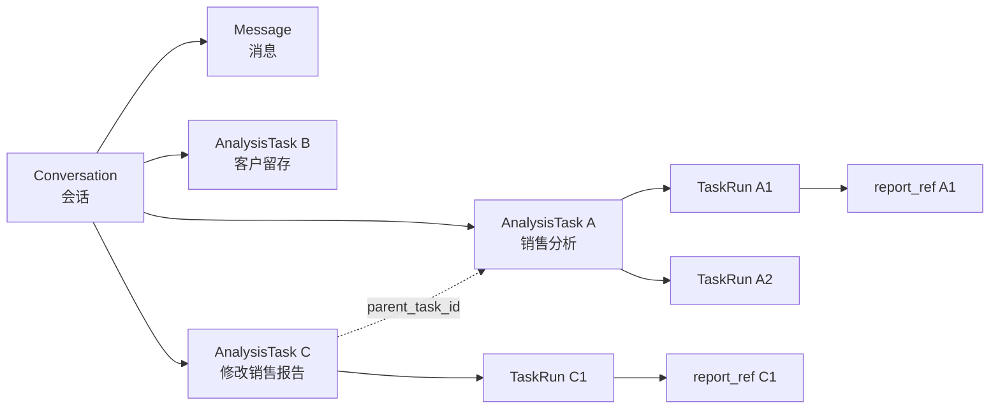
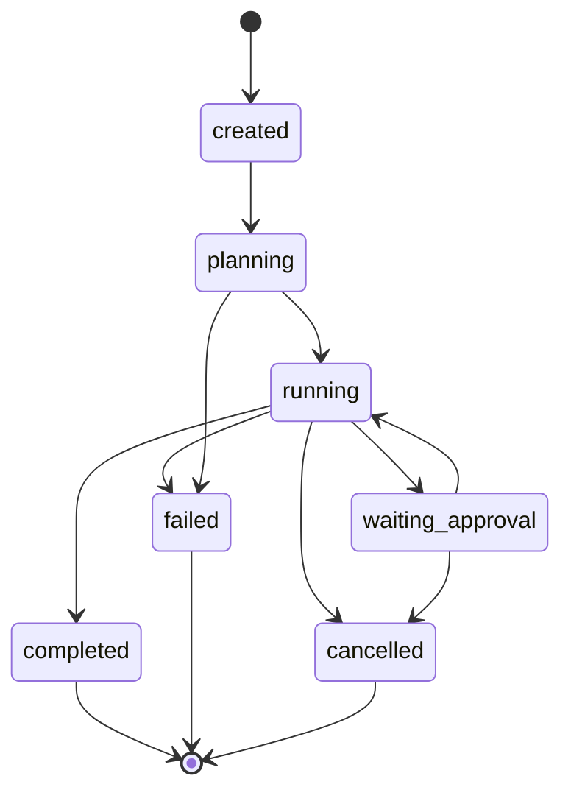
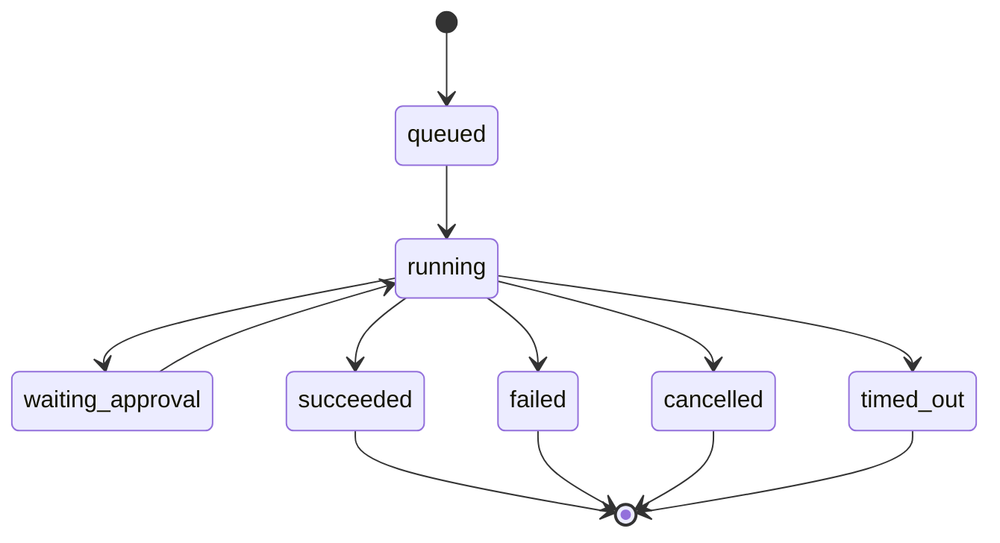

# 05 · Conversation 与 Analysis Task

> 依赖：`08-data-model.md`、`02-agent-runtime.md`。

---

## 1. Purpose

Reportify 是持续对话产品。本文定义三件事：

1. **Conversation** 如何承载多轮消息与多个分析任务。
2. **AnalysisTask** 如何表示一个分析目标及其多次执行。
3. **TaskRun** 如何表示一次 Agent 执行，并在取消、失败、审批、恢复时保持一致。

核心原则：**Conversation 是交互容器，Task 是分析单元，Run 是执行实例**。三者不能合并。

---

## 2. Non-Goals

- 不实现报告版本树与 diff（§12+）；只用 `parent_task_id` 与 `report_ref` 表达迭代关系。
- 不实现 Memory 写入与检索（§12+）。
- 不实现协作、多用户共享会话、权限分级。
- 不设计消息编辑、分支对话（fork）等高级交互。

---

## 3. 三者关系



示例：

| 用户输入 | 系统行为 |
| --- | --- |
| 「分析最近 30 天销售数据」 | 创建 Task A，Run A1 |
| 「再看一下客户留存」 | 同一 Conversation 创建 Task B |
| 「回到销售报告，把同比改成环比」 | 创建 Task C，`parent_task_id=A` |
| 「再补一张渠道分布图」 | 在 Task C 下新增 Run C2，产生新的 `report_ref` |

---

## 4. Message 模型

### 4.1 消息类型

| `message_type` | 是否落 `message` 表 | 说明 |
| --- | --- | --- |
| `user_message` | 是 | 用户原始输入 |
| `assistant_message` | 是 | 面向用户的回复 |
| `analysis_plan` | 是 | 结构化计划摘要，供 UI 展示 |
| `report_event` | 是 | 报告生成/失败/更新 |
| `system_event` | 是（重要事件） | 取消、审批、错误等 |
| `tool_call` / `tool_result` | 默认否 | 完整过程在 `run_event`；仅关键失败/审批可投影为消息 |

规则：

- `message` 是**产品语义与 UI 真相**；`run_event` 是**执行过程真相**。
- 不把每个 token 或每次模型请求写成消息。
- `content` 只放展示文本；结构化数据放 `payload`。

### 4.2 顺序与并发

- `sequence` 在 Conversation 内单调递增。
- 分配方式：锁定 `conversation` 行，取 `MAX(sequence)+1`，依赖唯一约束兜底。
- 同一 Conversation 只允许一个活跃 Run，避免交错写入。
- 消息写入与事件写入在同一事务边界内完成（或事件先写、消息后写并补偿）。

### 4.3 消息状态

MVP 不引入独立消息状态表；通过关联的 `task_run.status` 推导：

- 用户消息写入后即持久。
- 助手消息在 run 成功/失败时写入；流式增量只通过 SSE 推送，不逐段落库。

---

## 5. AnalysisTask 模型

### 5.1 字段语义

| 字段 | 语义 |
| --- | --- |
| `goal` | 用户原始需求，不被后续修订覆盖 |
| `parent_task_id` | 修订/追问来源；形成轻量版本链 |
| `status` | 任务级状态 |
| `skill_names` | 显式或匹配到的 Skill |
| `template_name` | 报告模板 |
| `data_source_refs` | 使用的数据源、表与过滤条件 |
| `plan` | 结构化分析计划（步骤、工具、预期产物） |
| `current_run_id` | 最近一次执行 |
| `report_ref_id` | 最近一次报告产物 |

### 5.2 状态机



| 状态 | 含义 | 进入条件 |
| --- | --- | --- |
| `created` | 任务已创建，尚未执行 | 用户消息写入后 |
| `planning` | 装配上下文、选择 Skill/Template | Run 开始前 |
| `running` | Agent 正在执行 | 调用 Agent |
| `waiting_approval` | 等待用户批准写工具 | `DeferredToolRequests` |
| `completed` | 产出报告或明确答复 | Run 成功且有 `report_ref` 或答案 |
| `failed` | 终态失败 | 不可重试错误、预算耗尽 |
| `cancelled` | 用户取消或审批超时 | 取消信号 |

**规则**：

- `completed` 后同一 Task 再执行时，创建新 Run，状态回到 `running`。
- `failed` / `cancelled` 不自动重试；用户发起新 Run 时状态重置为 `running`。
- 一个 Task 同时最多一个活跃 Run。

---

## 6. TaskRun 模型

### 6.1 状态机



### 6.2 状态与错误映射

| 结束方式 | Run 状态 | Task 状态 | 说明 |
| --- | --- | --- | --- |
| 正常完成 | `succeeded` | `completed` | 有报告或答复 |
| 用户取消 | `cancelled` | `cancelled` | 保留部分历史 |
| 超时 | `timed_out` | `failed` | 可重试 |
| 预算耗尽 | `failed` | `failed` | 附预算说明 |
| 模型/工具硬错误 | `failed` | `failed` | 保留事件 |
| 等待审批 | `waiting_approval` | `waiting_approval` | 可恢复 |

### 6.3 运行标识

- `run_id` 是日志、事件、审计、报告引用的统一关联键。
- 定时任务触发时，`trigger='scheduled'`，并携带 `idempotency_key`。
- 同一 Task 的多次 Run 保留全部历史，不覆盖。

---

## 7. 多任务与会话隔离

### 7.1 创建规则

| 情况 | 行为 |
| --- | --- |
| 用户提出新分析目标 | 创建新 Task |
| 用户明确「基于上一个报告修改」 | 新 Task，`parent_task_id` 指向来源 |
| 用户在当前 Task 下补充要求 | 同一 Task 新增 Run |
| 定时任务 | 每次触发创建独立 Task（或复用模板配置，§12+） |

**判定方式**：优先显式（用户指定、UI 传参）；否则由 Runtime 在规划阶段判断。判断结果写入 `plan` 事件，并投影为 `analysis_plan` 消息，用户可在 UI 中纠正。

### 7.2 上下文隔离

- Task 的默认上下文来自**该 Task 最近一次成功 Run** 的 `history_blob`。
- 不自动把其他 Task 的完整历史带入；需要引用时通过 `parent_task_id` 注入摘要：

```text
父任务目标：...
父任务报告：report_ref_id / 标题 / 关键结论（3 条以内）
父任务数据源与口径：...
```

- Conversation 级消息仅用于 UI 展示；除非用户引用，不进入模型上下文。

### 7.3 并发

- 同一 Conversation 同时只允许一个活跃 Run；新请求返回 `409 conversation_busy`。
- 不同 Conversation 可并发；各自独立锁。
- 锁使用 PostgreSQL advisory lock，连接断开自动释放。

---

## 8. 报告迭代（最小）

本阶段不做报告版本树，只保证可追溯：

1. 每次生成报告创建新的 `report_ref`。
2. 修订通过新 Task（`parent_task_id`）或同 Task 新 Run 表达。
3. UI 通过 `parent_task_id` 展示「基于哪一版修改」。
4. 历史 `report_ref` 不覆盖、不删除。

完整的版本 diff、回滚、分支属于 §12+。

---

## 9. 恢复与幂等

| 场景 | 处理 |
| --- | --- |
| 进程崩溃 | 启动时扫描超时 `running` 的 Run，标记 `failed`；Task 同步 `failed` |
| 用户重试 | 新建 Run，复用最近成功 Run 的 `history_blob` |
| 审批恢复 | 读取 `run_event(approval_required)` 与 `DeferredToolRequests`，带决策续跑 |
| 定时重复触发 | `idempotency_key` 命中已成功 Run 则直接返回 |
| 历史损坏 | 从 `message` 重建；仍失败则要求新建 Task |
| SSE 断线 | 按 `run_event.sequence` 重放，不影响执行 |

**MVP 限制**：不支持 Run 中途断点续跑；只支持「取消后重跑」与「审批后继续」。

---

## 10. 与 UI / API 的契约

| 能力 | 接口 | 说明 |
| --- | --- | --- |
| 会话列表 | `GET /api/v1/conversations` | 按 `last_message_at` 排序 |
| 消息历史 | `GET /api/v1/conversations/{id}/messages` | 分页，返回 `sequence` |
| 发送消息 | `POST /api/v1/conversations/{id}/messages` | 创建消息并触发 Run |
| 任务列表 | `GET /api/v1/conversations/{id}/tasks` | 含状态与报告引用 |
| 任务详情 | `GET /api/v1/tasks/{id}` | 含计划、运行、报告 |
| 执行事件 | `GET /api/v1/runs/{id}/events`（SSE） | 实时/重放 |
| 取消 | `POST /api/v1/runs/{id}/cancel` | 幂等 |
| 审批 | `POST /api/v1/runs/{id}/approvals/{approval_id}` | 允许/拒绝 |

UI 不直接写入 `task_run` 或 `run_event`；所有状态变更经服务层。

---

## 11. Failure Modes

| 场景 | 表现 | 处理 |
| --- | --- | --- |
| 重复发送 | 两条相同用户消息 | 客户端幂等键；服务端去重窗口 |
| 序列冲突 | 唯一约束失败 | 重试分配 sequence |
| 任务无 Run | `created` 悬挂 | 超时任务清理，标记 failed |
| 审批超时 | `waiting_approval` 长期挂起 | 默认 24h 自动取消并通知 |
| 多标签页并发 | 同时发起两个 Run | 第二个 409；UI 提示 |
| 报告引用丢失 | `report_ref` 文件不存在 | 标记 failed；可用 lineage 重生成 |

---

## 12. Open Questions

1. Task 创建由 Runtime 自动判断，还是 UI 强制用户选择「新分析 / 修改当前」？
2. `planning` 是否需要独立持久化阶段，还是并入首次 Run 的 `plan` 事件与 `analysis_plan` 消息？
3. 同一 Conversation 的多个 Task 是否需要在 UI 中并列展示，还是只显示当前 Task？
4. 审批恢复的超时时间与通知方式（站内/桌面）如何设定？
