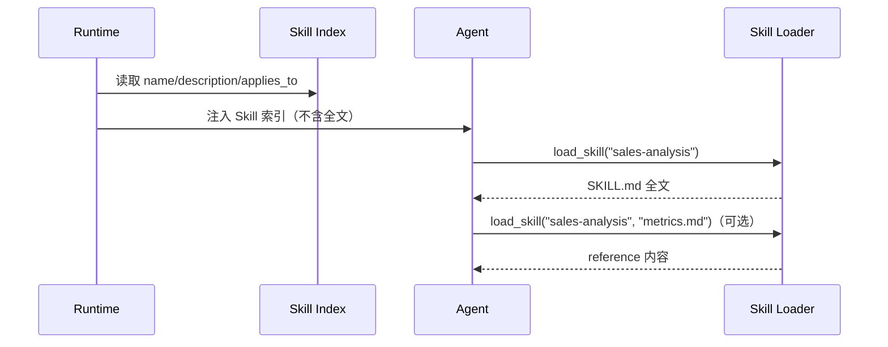

# 06 · Agent Workspace、Skills 与 Report Template

> 依赖：`02-agent-runtime.md`、`08-data-model.md`。

---

## 1. Purpose

让用户通过**文件**定义 Agent 的角色、长期偏好、执行规范、分析方法和报告结构，而不必每次在对话里重复解释。三类配置各司其职：

- Workspace 文件（SOUL / USER / AGENTS）：定义「是谁、偏好什么、必须遵守什么」。
- Skills：定义「这类分析怎么做」。
- Report Templates：定义「报告怎么呈现」。

---

## 2. Non-Goals

- 不实现 Skill 脚本执行与沙箱（MVP 禁用 `scripts/`）。
- 不实现可视化模板编辑器；模板以 YAML 文件为源。
- 不实现多工作区、多用户隔离。
- 不允许任何文件覆盖平台级安全策略。

---

## 3. 目录结构

```text
workspace/
├── AGENTS.md
├── SOUL.md
├── USER.md
├── skills/
│   ├── sales-analysis/
│   │   ├── SKILL.md
│   │   └── references/
│   │       └── metrics.md
│   ├── financial-analysis/
│   │   └── SKILL.md
│   └── data-quality/
│       └── SKILL.md
└── report-templates/
    ├── default.yaml
    ├── executive-report.yaml
    └── weekly-report.yaml
```

> 报告 HTML 默认写入独立的 `reports_dir`（见 `09-engineering.md`），不放在 workspace 内，避免配置目录与产物混在一起。

所有路径必须位于 workspace 根目录内；不允许符号链接逃逸。

---

## 4. 职责边界与优先级

### 4.1 职责矩阵

| 文件 | 决定 | 不决定 |
| --- | --- | --- |
| `SOUL.md` | 身份、语气、表达风格、事实与推测的边界 | 执行规则、权限、分析步骤 |
| `USER.md` | 语言、图表偏好、结论长度、默认对比周期 | 安全策略、工具授权 |
| `AGENTS.md` | 工作区执行规范：必须用工具取证、指标必须有口径、报告必须有来源 | 人格设定、报告排版细节 |
| `SKILL.md` | 特定领域的分析步骤、口径、工具建议、输出要求 | 展示样式、工具权限 |
| `report-template.yaml` | 报告章节、KPI 规则、图表偏好、主题 | 分析逻辑、数据访问 |

### 4.2 优先级

从高到低：

1. 平台不变量（代码，只读）。
2. `AGENTS.md`。
3. `SOUL.md`。
4. `USER.md`。
5. Task 目标与显式参数。
6. Skill。
7. Template。
8. 对话即时指令（只能细化，不能放宽安全约束）。

**冲突处理**：

- 任何时候都不得放宽工具授权、只读限制、报告 Schema 校验。
- USER 中写「允许执行写入操作」无效；必须通过工具授权流程。
- AGENTS 与 SOUL 重复时，加载器告警，以 AGENTS 为准。
- 同一文件内部矛盾时，拒绝加载并提示修复，不猜测。

---

## 5. 文件规范

| 文件 | 大小上限 | 必需 | 说明 |
| --- | --- | --- | --- |
| `SOUL.md` | 16 KB | 否 | 缺失时使用内置默认人格 |
| `USER.md` | 16 KB | 否 | 缺失时使用中性偏好 |
| `AGENTS.md` | 32 KB | 否 | 缺失时使用平台默认执行规范 |
| `SKILL.md` | 64 KB | 是（每个 Skill） | 必须有 frontmatter |
| `references/*` | 每文件 128 KB | 否 | 按需加载，不进入索引 |

编码 UTF-8；禁止二进制内容；加载时去除 BOM。

---

## 6. 加载与校验

```python
class WorkspaceLoader:
    def load(self) -> WorkspaceSnapshot: ...
    def skills_index(self) -> list[SkillMeta]: ...
    def invalidate(self, changed_path: str) -> None: ...
```

流程：

1. 解析目录，拒绝越界路径、符号链接逃逸与隐藏文件。
2. 读取 Markdown，校验大小与编码。
3. 解析 Skill frontmatter 与 Template YAML。
4. 计算 `content_hash`，写入 `skill_index` / `report_template_index` / `workspace_audit`。
5. 构建不可变 `WorkspaceSnapshot`，供本次 run 使用。

缓存：

- 进程内缓存按 `(path, mtime, size)` 失效。
- 文件变更后重建索引；正在运行的 run 继续使用旧快照，保证一致性。
- 校验失败时：该文件不生效，记录 `workspace_audit(action='rejected')`，任务继续使用默认值。

---

## 7. Skills

### 7.1 目录与 frontmatter

```markdown
---
name: sales-analysis
display_name: 销售分析
description: 分析销售额、订单量、渠道与区域表现，识别趋势与异常。
version: 1
applies_to: [销售, 收入, 订单, 渠道, 区域]
tools: [query_dataset, analyze_trend, compare_periods, analyze_distribution]
references: [metrics.md]
---

## 适用场景

...

## 分析步骤

1. 确认时间范围与对比周期
2. 计算核心指标与环比/同比
3. 按渠道与区域拆分
4. 识别异常并解释

## 分析规则

- 收入口径：已支付订单金额，排除退款
- 缺失值不得填 0，必须说明

## 输出要求

- 至少包含趋势、渠道贡献、异常三部分
```

字段约束：

| 字段 | 必需 | 说明 |
| --- | --- | --- |
| `name` | 是 | 与目录名一致，`[a-z0-9-]+` |
| `description` | 是 | 索引展示，≤200 字符 |
| `version` | 是 | 整数，内容变化时递增 |
| `applies_to` | 否 | 关键词，用于匹配 |
| `tools` | 否 | 建议工具，不是权限 |
| `references` | 否 | 按需加载的文件名 |

### 7.2 渐进式加载



规则：

- 索引常驻指令，全文按需加载；不得把所有 Skill 全文塞入上下文。
- 用户显式指定 Skill 时，直接加载全文，跳过匹配。
- 自动匹配优先级：`applies_to` 关键词 > `description` 相似度 > 不匹配。
- 一次 run 最多加载 3 个 Skill；超出时要求用户选择。

### 7.3 Skill 安全

- Skill 是**指导**，不是权限：不能获取未授权工具，不能绕过 Tool Registry。
- `scripts/` 在 MVP 中不执行；目录存在也不加载。
- `references/` 只能读取 Skill 目录内文件，防路径穿越。
- Skill 内容由用户编写，但仍视为不可信文本：不得包含可执行 HTML/JS；渲染时转义。
- Skill 不能修改 `AGENTS.md` / `SOUL.md` / 平台规则。

---

## 8. Report Templates

### 8.1 YAML Schema

```yaml
schema_version: 1
name: executive-report
display_name: 经营分析报告
description: 面向管理层的经营概览、趋势、异常与建议
language: zh-CN
theme: warm-editorial
sections:
  - id: overview
    title: 经营概览
    required: true
    blocks: [kpi, text]
  - id: trends
    title: 趋势分析
    required: true
    blocks: [chart, table]
  - id: anomalies
    title: 异常数据
    required: false
    blocks: [table, text]
kpis:
  max: 5
  require_definition: true
charts:
  preferred: [line, bar]
  max_per_section: 3
output:
  include_sources: true
  include_methodology: true
  self_contained: true
```

### 8.2 允许的 block 类型

**实现词汇（M2 起为唯一真相源）**：`ReportSchema` 只接受下列四种 block，模板校验也使用同一集合。

| `type` | 关键字段 | 说明 |
| --- | --- | --- |
| `kpi` | `label`、`value`、`unit`、`definition`、`lineage_refs` | KPI 卡片 |
| `chart` | `chart_type`（`line` / `bar` / `pie` / `scatter`）、`series`、`definition`、`lineage_refs` | ECharts 图表数据 |
| `table` | `columns`、`rows`、`lineage_refs` | 数据表格 |
| `text` | `text` | 说明、结论、口径注解 |

**设计名到实现名的映射**（早期草稿用过更细的名字，实现已收敛）：

| 设计名 | 实现 |
| --- | --- |
| `line_chart` / `bar_chart` / `pie_chart` / `scatter_chart` | `chart` + `chart_type` |
| `conclusion` | `text` |
| `source_note` | 渲染器统一生成的 lineage 区块，不需要单独 block |
| `comparison` | 未实现；用 `table` 表达对比结果（§12+ 可增加专用 block） |

**禁止**：`html`、`script`、`iframe`、自定义 JS、外部资源引用。

### 8.3 与 Report Schema 的关系

- Template 约束**结构与数量**：章节顺序、必需章节、每节可用 block、KPI 上限、图表偏好。
- Report Schema 是 Agent 的实际输出，必须通过 Pydantic 校验，并满足 Template 约束。
- 校验分两层：

```text
ReportSchema（类型/字段/引用完整性）
        ∩
TemplateConstraint（章节/block/数量/主题）
        ↓
Renderer（Jinja2，自动转义）
```

- Template 不能携带任意 HTML；渲染器只认识预定义 block。

### 8.4 选择与校验

| 场景 | 选择方式 |
| --- | --- |
| 用户显式指定 | 直接使用 |
| USER.md 设置默认 | 使用默认模板 |
| 任务关键词匹配 | 按 `description` / name 匹配 |
| 无匹配 | `default.yaml` |

校验：`schema_version` 支持范围、section id 唯一、block 类型合法、必需章节存在、字符串长度限制。失败时拒绝该模板并回退默认。

---

## 9. 配置组合示例

| 场景 | SOUL | USER | AGENTS | Skill | Template |
| --- | --- | --- | --- | --- | --- |
| 销售周报 | 专业分析师 | 中文、简洁 | 必须给口径 | `sales-analysis` | `weekly-report` |
| 财务月报 | 严谨、保守 | 中文、KPI 优先 | 必须标注假设 | `financial-analysis` | `executive-report` |
| 数据质量检查 | 直接指出问题 | 中文、含表格 | 不得编造缺失值 | `data-quality` | `default` |

---

## 10. Failure Modes

| 场景 | 表现 | 处理 |
| --- | --- | --- |
| YAML 语法错误 | 模板不可用 | 拒绝加载，回退默认，记录审计 |
| frontmatter 缺失 | Skill 无法索引 | 跳过该 Skill，提示修复 |
| 文件过大 | 加载变慢 | 拒绝并提示上限 |
| 路径穿越 | 读取 workspace 外文件 | 拒绝，记录安全事件 |
| Skill 建议未授权工具 | 工具不可见 | 忽略建议，正常执行 |
| 模板引用未知 block | 无法渲染 | 校验失败，回退默认 |
| 文件运行中被修改 | 快照不一致 | 当前 run 使用旧快照，下次生效 |

---

## 11. Open Questions

1. Skill 自动匹配是否需要引入 embedding，还是关键词 + LLM 选择足够？
2. `references/` 是否需要独立的加载工具，还是复用 `load_skill` 的第二参数？
3. 模板是否需要版本迁移机制（`schema_version` 升级）？
4. 是否允许用户在 UI 中编辑文件，还是只读展示、要求用外部编辑器？
