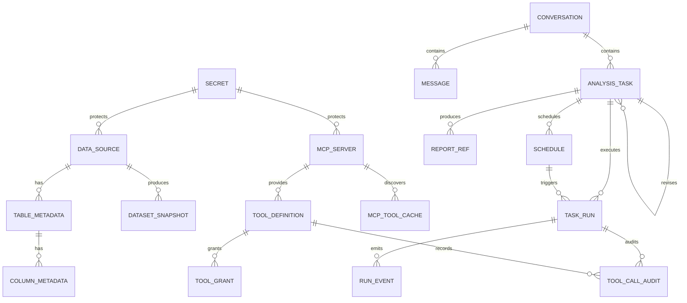

# 08 · 数据模型

> 范围：§1–§11 的持久化模型与存储分工。  
> 不在范围：Memory 向量检索、Context 压缩、Report Version（§12+，另开 Spec）。  
> 约定：本文只定义结构与约束，不包含 DDL、SQLAlchemy 模型或迁移脚本。

---

## 1. Purpose

为 Reportify 的模块化单体提供一份**单一、字段级、可交叉引用**的数据模型，使 Agent Runtime、Data Connector、Tool Registry、MCP Hub、Conversation/Task 与报告契约使用同一套实体与命名。

成功标准：

- 任一模块文档引用实体时，字段名与语义以本文为准。
- 报告 lineage、工具审计、MCP 授权、任务恢复所需信息都有明确落点。
- 不引入多租户、RBAC 等本次范围外结构。

---

## 2. Non-Goals

- 不设计 Memory 的向量/Embedding 存储（`memory` 表见 §6.21）。
- 不设计 Report Version / Revision 全量模型（仅保留 `report_ref` 最小引用）。
- 不设计 Scheduler 的通知、依赖与补跑策略（`schedule` 表本身见 §6.20）。
- 不设计多租户隔离字段（`tenant_id`、行级安全）。
- 不规定具体 SQL DDL、索引语句与 Alembic 版本。

---

## 3. 全局约定

| 项 | 约定 |
| --- | --- |
| 主键 | `id UUID`，应用层生成（UUID v4；未来换 UUIDv7 不改变表结构） |
| 时间 | `timestamptz`，统一 UTC；`created_at` / `updated_at` 默认 `now()` |
| 枚举 | `text` + `CHECK` 约束，不用 PostgreSQL ENUM（迁移成本低） |
| 扩展字段 | `metadata JSONB NOT NULL DEFAULT '{}'`；不用于高频过滤列 |
| 命名 | `snake_case`；外键 `<entity>_id`；联合唯一约束显式命名 |
| 索引 | 所有外键列建索引；高频查询按本文 §8 追加复合索引 |
| 删除 | 审计表只追加；业务表用 `status` / `archived_at` 软删除 |
| 大对象 | 报告 HTML、Provider 历史放文件或 `JSONB`，不放大字段到热点表 |
| 敏感值 | 不落明文；统一走 `secret` 表与 `secret_id` 引用 |

---

## 4. 存储分工

| 存储 | 职责 | 不得存放 |
| --- | --- | --- |
| PostgreSQL | 全部事务性实体、审计、报告引用、工具注册与授权 | 大体积分析数据、报告 HTML 正文 |
| Redis | ARQ 队列、SSE/事件 fan-out、短期锁、限流计数、查询结果短期缓存 | 任何需要恢复的真相数据 |
| 文件系统 | `workspace/`（SOUL/USER/AGENTS/Skills/Templates）、生成的 HTML 报告、日志 | 凭证明文、可被 Agent 任意读写的执行脚本 |

**恢复原则**：Redis 丢失不影响正确性；PostgreSQL + `workspace/` 文件足以重建一次运行所需的全部输入。

---

## 5. 实体总览

共 18 个业务实体 + 1 个平台表（`secret`）。

| # | 实体 | 用途 | 主要写入方 |
| --- | --- | --- | --- |
| 1 | `data_source` | 数据源连接配置 | Data Connector |
| 2 | `table_metadata` | 表/视图发现结果 | Data Connector |
| 3 | `column_metadata` | 字段类型、统计与用户标签 | Data Connector / 管理台 |
| 4 | `dataset_snapshot` | 查询条件、范围、样本量与 lineage | Data Connector / Runtime |
| 5 | `conversation` | 会话 | Conversation Service |
| 6 | `message` | 面向 UI 的消息与事件 | Conversation Service |
| 7 | `analysis_task` | 一次分析目标与状态 | Task Service |
| 8 | `task_run` | 一次 Agent 执行 | Agent Runtime |
| 9 | `run_event` | 执行事件流（审计/回放） | Agent Runtime |
| 10 | `tool_definition` | 统一工具注册表 | Tool Registry |
| 11 | `tool_grant` | 工具授权（全局/会话/任务） | Tool Registry / 管理台 |
| 12 | `tool_call_audit` | 工具调用审计 | Tool Registry / MCP Runtime |
| 13 | `mcp_server` | MCP Server 配置 | MCP Hub |
| 14 | `mcp_tool_cache` | MCP 工具发现缓存 | MCP Hub |
| 15 | `skill_index` | Skill 元数据索引 | Skills Manager |
| 16 | `report_template_index` | 模板索引 | Template Manager |
| 17 | `report_ref` | 报告产物最小引用 | Report 工具（§12+ 实现） |
| 18 | `workspace_audit` | Workspace 文件加载/变更审计 | Workspace Loader |
| P1 | `secret` | 加密凭证 | 管理台 / 连接测试 |

---

## 6. 字段定义

### 6.1 `secret`（平台表）

| 字段 | 类型 | 约束 | 说明 |
| --- | --- | --- | --- |
| `id` | UUID | PK | |
| `name` | text | NOT NULL, UNIQUE | 如 `ds_analytics_db`、`mcp_github_token` |
| `ciphertext` | bytea | NOT NULL | AES-GCM 密文 |
| `nonce` | bytea | NOT NULL | 每次写入随机生成 |
| `key_version` | int | NOT NULL, DEFAULT 1 | 支持密钥轮换 |
| `created_at` / `updated_at` / `rotated_at` | timestamptz | | |

**规则**：API 永不返回明文；读取只在 Connector/MCP Runtime 内部发生；日志与审计只记录 `secret_id`。

### 6.2 `data_source`

| 字段 | 类型 | 约束 | 说明 |
| --- | --- | --- | --- |
| `id` | UUID | PK | |
| `name` | text | NOT NULL, UNIQUE | 展示名，如 `analytics_db` |
| `type` | text | NOT NULL, CHECK | MVP：`postgresql`；预留 `mysql` / `csv` / `excel` / `rest` |
| `host` / `port` / `database` / `username` | text / int / text / text | host 非空（PG） | 连接信息 |
| `ssl_mode` | text | | `disable` / `require` / `verify-full` |
| `secret_id` | UUID | FK → `secret.id`, NULL | 密码或连接串凭证 |
| `options` | JSONB | NOT NULL DEFAULT `{}` | `schema_allowlist`、`statement_timeout_ms`、`max_rows`、`read_only` |
| `status` | text | NOT NULL, CHECK | `active` / `disabled` / `error` |
| `last_tested_at` | timestamptz | | |
| `last_error` | text | | 脱敏后的错误摘要 |
| `created_at` / `updated_at` | timestamptz | | |

**约束**：`options.read_only` 默认 `true`；MVP 强制只读，写入能力不属于本版本。

### 6.3 `table_metadata`

| 字段 | 类型 | 约束 | 说明 |
| --- | --- | --- | --- |
| `id` | UUID | PK | |
| `data_source_id` | UUID | FK → `data_source.id`, NOT NULL | |
| `schema_name` | text | NOT NULL | 如 `public` |
| `table_name` | text | NOT NULL | |
| `table_type` | text | CHECK | `table` / `view` / `materialized_view` |
| `row_estimate` | bigint | | 来自统计信息，不保证精确 |
| `comment` | text | | 数据库原生注释 |
| `columns_hash` | text | NOT NULL | 列集合指纹，用于漂移检测 |
| `synced_at` | timestamptz | NOT NULL | |
| `created_at` / `updated_at` | timestamptz | | |

**唯一**：`(data_source_id, schema_name, table_name)`。

### 6.4 `column_metadata`

| 字段 | 类型 | 约束 | 说明 |
| --- | --- | --- | --- |
| `id` | UUID | PK | |
| `table_metadata_id` | UUID | FK → `table_metadata.id`, NOT NULL | |
| `column_name` | text | NOT NULL | 原始字段名 |
| `ordinal` | int | NOT NULL | 列顺序 |
| `native_type` | text | NOT NULL | 如 `numeric(12,2)`、`timestamptz` |
| `normalized_type` | text | NOT NULL, CHECK | `numeric` / `temporal` / `categorical` / `text` / `boolean` / `json` / `unknown` |
| `nullable` | boolean | NOT NULL | |
| `is_primary_key` | boolean | NOT NULL DEFAULT false | |
| `stats` | JSONB | NOT NULL DEFAULT `{}` | `null_ratio`、`distinct_count`、`min`、`max`、`sample_values`（限 20 个） |
| `display_name` | text | | 用户展示名 |
| `unit` | text | | 单位 |
| `description` | text | | 用户描述 |
| `user_tags` | text[] | NOT NULL DEFAULT `{}` | 仅辅助展示，不是分析前置条件 |
| `profile_version` | int | NOT NULL DEFAULT 0 | 统计刷新版本 |
| `created_at` / `updated_at` | timestamptz | | |

**唯一**：`(table_metadata_id, column_name)`。  
**注意**：`normalized_type` 只表达数据类型，不推断业务语义；`status=1` 只能是 `categorical`。

### 6.5 `dataset_snapshot`

| 字段 | 类型 | 约束 | 说明 |
| --- | --- | --- | --- |
| `id` | UUID | PK | |
| `data_source_id` | UUID | FK → `data_source.id`, NOT NULL | |
| `table_metadata_id` | UUID | FK → `table_metadata.id`, NULL | 多表查询时为空 |
| `run_id` | UUID | FK → `task_run.id`, NULL | 关联执行 |
| `purpose` | text | CHECK | `inspect` / `profile` / `analysis` / `report` |
| `sql` | text | NOT NULL | 规范化后的只读 SQL |
| `params` | JSONB | NOT NULL DEFAULT `{}` | 绑定参数，敏感值脱敏 |
| `query_fingerprint` | text | NOT NULL | `sha256(sql + params + range)` |
| `row_count` | bigint | NOT NULL | 实际读取行数 |
| `columns` | JSONB | NOT NULL | 结果列与类型 |
| `time_range` | tstzrange | NULL | 时间过滤范围 |
| `filters` | JSONB | NOT NULL DEFAULT `{}` | 结构化过滤条件 |
| `created_at` | timestamptz | NOT NULL | |
| `expires_at` | timestamptz | NULL | 可选 TTL |

**用途**：报告「数据来源 / 计算口径 / 样本量」的可追溯引用；不保存原始数据行。

> 实现注记（2026-11-22）：`time_range` 只在 `QuerySpec.time_range` 同时给出起止时写入 `tstzrange`；
> 仅给一端时仍为 `NULL`，范围条件保存在 `filters`。`run_id` 由内置工具在查询成功后回填。

### 6.6 `conversation`

| 字段 | 类型 | 约束 | 说明 |
| --- | --- | --- | --- |
| `id` | UUID | PK | |
| `title` | text | NOT NULL DEFAULT '新会话' | 可自动生成 |
| `workspace_key` | text | NOT NULL DEFAULT `'default'` | 单工作区占位，不做多租户 |
| `status` | text | NOT NULL, CHECK | `active` / `archived` |
| `last_message_at` | timestamptz | NULL | 列表排序 |
| `metadata` | JSONB | NOT NULL DEFAULT `{}` | |
| `created_at` / `updated_at` / `archived_at` | timestamptz | | |

### 6.7 `message`

| 字段 | 类型 | 约束 | 说明 |
| --- | --- | --- | --- |
| `id` | UUID | PK | |
| `conversation_id` | UUID | FK → `conversation.id`, NOT NULL | |
| `task_id` | UUID | FK → `analysis_task.id`, NULL | |
| `run_id` | UUID | FK → `task_run.id`, NULL | |
| `sequence` | bigint | NOT NULL | 会话内单调递增 |
| `role` | text | NOT NULL, CHECK | `user` / `assistant` / `tool` / `system` |
| `message_type` | text | NOT NULL, CHECK | `user_message` / `assistant_message` / `tool_call` / `tool_result` / `system_event` / `analysis_plan` / `report_event` |
| `content` | text | NOT NULL DEFAULT `''` | 面向 UI 的文本 |
| `payload` | JSONB | NOT NULL DEFAULT `{}` | 工具参数摘要、计划、报告引用等 |
| `created_at` | timestamptz | NOT NULL | |

**唯一**：`(conversation_id, sequence)`。  
**规则**：`message` 是 UI 与产品语义的真相；模型上下文真相是 `task_run.history_blob`，两者不互相替代。

### 6.8 `analysis_task`

| 字段 | 类型 | 约束 | 说明 |
| --- | --- | --- | --- |
| `id` | UUID | PK | |
| `conversation_id` | UUID | FK → `conversation.id`, NOT NULL | |
| `parent_task_id` | UUID | FK → `analysis_task.id`, NULL | 迭代/修订来源 |
| `goal` | text | NOT NULL | 用户原始需求 |
| `status` | text | NOT NULL, CHECK | `created` / `planning` / `running` / `waiting_approval` / `completed` / `failed` / `cancelled` |
| `skill_names` | text[] | NOT NULL DEFAULT `{}` | 匹配或用户指定的 Skill |
| `template_name` | text | NULL | 选中的报告模板 |
| `data_source_refs` | JSONB | NOT NULL DEFAULT `[]` | `[{data_source_id, table, filters}]` |
| `plan` | JSONB | NOT NULL DEFAULT `{}` | 结构化分析计划 |
| `current_run_id` | UUID | FK → `task_run.id`, NULL | |
| `report_ref_id` | UUID | FK → `report_ref.id`, NULL | 最小引用 |
| `error` | JSONB | NULL | 结构化错误 |
| `created_at` / `updated_at` / `completed_at` | timestamptz | | |

**规则**：一个 Conversation 可有多个 AnalysisTask；回到旧报告修改时新建 Task 并设置 `parent_task_id`，不覆盖历史。

### 6.9 `task_run`

| 字段 | 类型 | 约束 | 说明 |
| --- | --- | --- | --- |
| `id` | UUID | PK | |
| `task_id` | UUID | FK → `analysis_task.id`, NOT NULL | |
| `conversation_id` | UUID | FK → `conversation.id`, NOT NULL | 查询冗余 |
| `trigger` | text | CHECK | `interactive` / `scheduled` / `api` |
| `status` | text | NOT NULL, CHECK | `queued` / `running` / `waiting_approval` / `succeeded` / `failed` / `cancelled` / `timed_out` |
| `model_name` | text | NOT NULL | 如 `deepseek-flash` |
| `model_settings` | JSONB | NOT NULL DEFAULT `{}` | thinking、max_tokens 等 |
| `limits` | JSONB | NOT NULL DEFAULT `{}` | request/tool/token/cost 限制 |
| `usage` | JSONB | NOT NULL DEFAULT `{}` | 实际用量（请求、工具、token、成本） |
| `pending_approvals` | JSONB | NOT NULL DEFAULT `[]` | 待审批工具调用；每项含 `approval_id`、`tool_call_id`、`tool_name`、`args_redacted`、`risk`、`decision` |
| `schedule_id` | UUID | FK → `schedule.id`, NULL, ON DELETE SET NULL | 由哪个定时任务派发（M8） |
| `idempotency_key` | text | NULL, UNIQUE（部分索引，仅非空） | 创建幂等键；定时为 `schedule:<id>:<scheduled_for>` |
| `history_blob` | JSONB | NULL | PydanticAI `ModelMessagesTypeAdapter` 结果 |
| `error` | JSONB | NULL | |
| `cancel_requested_at` | timestamptz | NULL | |
| `started_at` / `finished_at` | timestamptz | | |
| `created_at` / `updated_at` | timestamptz | | |

**规则**：`history_blob` 是恢复上下文的唯一模型侧来源；恢复前必须经 `sanitize_messages()`。

### 6.10 `run_event`

| 字段 | 类型 | 约束 | 说明 |
| --- | --- | --- | --- |
| `id` | bigserial | PK | 追加写 |
| `run_id` | UUID | FK → `task_run.id`, NOT NULL | |
| `sequence` | bigint | NOT NULL | 运行内单调递增 |
| `event_type` | text | NOT NULL, CHECK | `run_started` / `plan` / `model_request` / `tool_call` / `tool_result` / `usage` / `approval_required` / `report_generated` / `run_completed` / `error` |
| `payload` | JSONB | NOT NULL DEFAULT `{}` | 事件数据（已脱敏） |
| `created_at` | timestamptz | NOT NULL | |

**唯一**：`(run_id, sequence)`。**索引**：`(run_id, created_at)`。

### 6.11 `tool_definition`

| 字段 | 类型 | 约束 | 说明 |
| --- | --- | --- | --- |
| `id` | UUID | PK | |
| `name` | text | NOT NULL, UNIQUE | 命名空间：`builtin.query_dataset`、`mcp.github.search_issues` |
| `kind` | text | NOT NULL, CHECK | `builtin_data` / `builtin_analysis` / `report` / `mcp` |
| `source_id` | UUID | FK → `mcp_server.id`, NULL | 仅 MCP |
| `display_name` | text | NOT NULL | |
| `description` | text | NOT NULL | 面向模型的描述（内置工具由代码定义） |
| `input_schema` | JSONB | NOT NULL | JSON Schema |
| `output_schema` | JSONB | NULL | 可选 |
| `risk_level` | text | NOT NULL, CHECK | `read` / `write` / `destructive` |
| `enabled` | boolean | NOT NULL DEFAULT true | |
| `requires_approval` | boolean | NOT NULL DEFAULT false | 写/破坏性默认 true |
| `cache_version` | text | NULL | MCP Schema 指纹 |
| `discovered_at` / `updated_at` | timestamptz | | |

**规则**：MCP 工具默认 `risk_level='write'`（保守），由用户显式降为 `read`；不能根据名称/描述自动认定只读。

> 实现注记（2026-11-22，M3）：`source_id` 的 `FK → mcp_server.id`（`ON DELETE SET NULL`）已由 `0004` 迁移补齐；
> M2 曾以普通 `UUID` 列过渡。

### 6.12 `tool_grant`

| 字段 | 类型 | 约束 | 说明 |
| --- | --- | --- | --- |
| `id` | UUID | PK | |
| `tool_definition_id` | UUID | FK → `tool_definition.id`, NOT NULL | |
| `scope` | text | NOT NULL, CHECK | `global` / `conversation` / `task` |
| `scope_id` | UUID | NULL | 对应会话或任务 |
| `allowed` | boolean | NOT NULL DEFAULT false | 默认拒绝 |
| `risk_acknowledged` | boolean | NOT NULL DEFAULT false | 写操作必须显式确认 |
| `granted_by` | text | NOT NULL DEFAULT `'local'` | 单用户 |
| `granted_at` | timestamptz | NOT NULL | |
| `expires_at` | timestamptz | NULL | |

**唯一**：`(tool_definition_id, scope, scope_id)`。  
**优先级**：`task` > `conversation` > `global`；未命中任何允许记录即拒绝。

### 6.13 `tool_call_audit`

| 字段 | 类型 | 约束 | 说明 |
| --- | --- | --- | --- |
| `id` | UUID | PK | |
| `run_id` | UUID | FK → `task_run.id`, NOT NULL | |
| `tool_definition_id` | UUID | FK → `tool_definition.id`, NULL | 工具可能已删除 |
| `tool_name` | text | NOT NULL | 冗余快照 |
| `source` | text | NOT NULL, CHECK | `builtin` / `mcp` |
| `arguments_redacted` | JSONB | NOT NULL DEFAULT `{}` | 敏感参数脱敏 |
| `result_summary` | JSONB | NOT NULL DEFAULT `{}` | 不存完整大结果 |
| `status` | text | NOT NULL, CHECK | `allowed` / `denied` / `approved` / `rejected` / `succeeded` / `failed` / `timeout` |
| `error_code` | text | NULL | |
| `duration_ms` | int | NULL | |
| `created_at` | timestamptz | NOT NULL | |

**索引**：`(run_id, created_at)`、`(tool_name, created_at)`。

### 6.14 `mcp_server`

| 字段 | 类型 | 约束 | 说明 |
| --- | --- | --- | --- |
| `id` | UUID | PK | |
| `name` | text | NOT NULL, UNIQUE | 展示名 |
| `slug` | text | NOT NULL, UNIQUE | 工具命名空间，`[a-z0-9-]+` |
| `transport` | text | NOT NULL, CHECK | MVP：`streamable_http`；预留 `stdio` |
| `url` | text | NULL | HTTP 端点 |
| `command` / `args` / `cwd` | text / JSONB / text | NULL | stdio 预留，默认禁用 |
| `auth_type` | text | NOT NULL, CHECK | `none` / `bearer` / `oauth` |
| `secret_id` | UUID | FK → `secret.id`, NULL | Token/OAuth 凭证 |
| `headers` | JSONB | NOT NULL DEFAULT `{}` | 非敏感请求头 |
| `options` | JSONB | NOT NULL DEFAULT `{}` | `read_timeout_seconds`、`max_result_bytes`、速率限制 |
| `enabled` | boolean | NOT NULL DEFAULT true | |
| `status` | text | NOT NULL, CHECK | `unknown` / `connected` / `error` / `disabled` |
| `last_tested_at` | timestamptz | NULL | |
| `last_error` | text | NULL | |
| `protocol_version` | text | NULL | 如 `2026-07-28` |
| `server_info` | JSONB | NOT NULL DEFAULT `{}` | 握手返回 |
| `instructions` | text | NULL | 默认不注入模型 |
| `created_at` / `updated_at` | timestamptz | | |

### 6.15 `mcp_tool_cache`

| 字段 | 类型 | 约束 | 说明 |
| --- | --- | --- | --- |
| `id` | UUID | PK | |
| `mcp_server_id` | UUID | FK → `mcp_server.id`, NOT NULL | |
| `tool_name` | text | NOT NULL | Server 内原始名 |
| `description` | text | NOT NULL DEFAULT `''` | 不可信内容 |
| `input_schema` | JSONB | NOT NULL | |
| `annotations` | JSONB | NOT NULL DEFAULT `{}` | 仅记录，不作为权限依据 |
| `schema_hash` | text | NOT NULL | 变化则失效 |
| `discovered_at` | timestamptz | NOT NULL | |

**唯一**：`(mcp_server_id, tool_name)`。缓存可随时重建，不作为连接状态唯一依据。

### 6.16 `skill_index`

| 字段 | 类型 | 约束 | 说明 |
| --- | --- | --- | --- |
| `id` | UUID | PK | |
| `name` | text | NOT NULL, UNIQUE | 目录名 |
| `display_name` / `description` | text | NOT NULL | 来自 SKILL.md 头部 |
| `path` | text | NOT NULL | workspace 相对路径 |
| `content_hash` | text | NOT NULL | 变更检测 |
| `enabled` | boolean | NOT NULL DEFAULT true | |
| `indexed_at` | timestamptz | NOT NULL | |

### 6.17 `report_template_index`

| 字段 | 类型 | 约束 | 说明 |
| --- | --- | --- | --- |
| `id` | UUID | PK | |
| `name` | text | NOT NULL, UNIQUE | |
| `display_name` / `description` | text | NOT NULL | |
| `path` | text | NOT NULL | |
| `format` | text | NOT NULL DEFAULT `'yaml'` | |
| `schema_version` | text | NOT NULL | 模板 Schema 版本 |
| `content_hash` | text | NOT NULL | |
| `enabled` | boolean | NOT NULL DEFAULT true | |
| `indexed_at` | timestamptz | NOT NULL | |

### 6.18 `report_ref`

> 已含版本链（M9）。渲染由 `echarts-v1` 完成，表内保存原始 Report Schema 供 diff 使用。

| 字段 | 类型 | 约束 | 说明 |
| --- | --- | --- | --- |
| `id` | UUID | PK | |
| `task_id` | UUID | FK → `analysis_task.id`, NOT NULL | |
| `run_id` | UUID | FK → `task_run.id`, NOT NULL | |
| `title` | text | NOT NULL | |
| `format` | text | NOT NULL DEFAULT `'html'` | |
| `storage_path` | text | NOT NULL | 文件相对路径 |
| `content_hash` | text | NOT NULL | |
| `lineage` | JSONB | NOT NULL DEFAULT `{}` | 数据源、SQL、口径、样本量、耗时 |
| `schema` | JSONB | NULL | 经校验的 Report Schema（M9 起写入；老数据为空） |
| `version` | int | NOT NULL DEFAULT 1 | Task 内递增 |
| `parent_report_id` | UUID | FK → `report_ref.id`, NULL, SET NULL | 上一版 |
| `status` | text | NOT NULL, CHECK | `generated` / `failed` |
| `created_at` | timestamptz | NOT NULL | |

**索引**：`(task_id, created_at)`、`(task_id, version)`。

### 6.19 `workspace_audit`

| 字段 | 类型 | 约束 | 说明 |
| --- | --- | --- | --- |
| `id` | UUID | PK | |
| `file_path` | text | NOT NULL | workspace 相对路径 |
| `content_hash` | text | NOT NULL | |
| `action` | text | NOT NULL, CHECK | `loaded` / `changed` / `rejected` |
| `actor` | text | NOT NULL DEFAULT `'system'` | |
| `detail` | JSONB | NOT NULL DEFAULT `{}` | 校验失败原因等 |
| `created_at` | timestamptz | NOT NULL | |

### 6.20 `schedule`

> M8 引入；`08 §1` 原先把调度表列为范围外，现由本表接管（不再是「另开 Spec」）。

| 字段 | 类型 | 约束 | 说明 |
| --- | --- | --- | --- |
| `id` | UUID | PK | |
| `task_id` | UUID | FK → `analysis_task.id`, NOT NULL, CASCADE | 被重复执行的任务 |
| `conversation_id` | UUID | FK → `conversation.id`, NOT NULL, CASCADE | 冗余，用于列表与业务锁 |
| `name` | text | NOT NULL | 显示名，默认取 `task.goal` 前 40 字 |
| `cron` | text(120) | NOT NULL | 5 字段：分 时 日 月 周 |
| `timezone` | text(64) | NOT NULL DEFAULT `'UTC'` | IANA 名称 |
| `enabled` | bool | NOT NULL DEFAULT true | 暂停后不再被认领 |
| `next_run_at` | timestamptz | NOT NULL | 始终为未来最近一次 |
| `last_run_at` | timestamptz | NULL | 最近一次派发对应的计划时刻 |
| `last_run_id` | UUID | FK → `task_run.id`, NULL, SET NULL | |
| `last_status` | text | NULL, CHECK | `dispatched` / `skipped` / `failed` |
| `last_error` | JSONB | NULL | `{code, detail}` |
| `created_at` / `updated_at` | timestamptz | | |

**唯一**：`(task_id, cron, timezone)`。**索引**：`(enabled, next_run_at)`（tick 认领路径）。
**规则**：tick 用 `FOR UPDATE SKIP LOCKED` 认领到期行，先推进 `next_run_at` 再派发；
错过窗口不补跑；删除 schedule 只把历史 Run 的 `schedule_id` 置空。

### 6.21 `memory`

> M10 引入；用户显式写入的长期笔记，词面召回后注入指令（无 Embedding）。

| 字段 | 类型 | 约束 | 说明 |
| --- | --- | --- | --- |
| `id` | UUID | PK | |
| `scope` | text(16) | NOT NULL, CHECK | `global` / `conversation` |
| `scope_id` | UUID | FK → `conversation.id`, NULL, CASCADE | `scope=conversation` 时必填 |
| `kind` | text(16) | NOT NULL DEFAULT `'fact'`, CHECK | `preference` / `fact` / `definition` |
| `content` | text | NOT NULL | 单条 ≤1000 字符（API 校验） |
| `tags` | text[] | NOT NULL DEFAULT `{}` | 召回时与正文一起参与打分 |
| `created_by` | text(16) | NOT NULL DEFAULT `'user'` | Agent 不自动写入 |
| `last_used_at` | timestamptz | NULL | 最近一次被注入 |
| `created_at` / `updated_at` | timestamptz | | |

**CHECK**：`(scope='global' AND scope_id IS NULL) OR (scope='conversation' AND scope_id IS NOT NULL)`。
**索引**：`(scope, scope_id)`、`(created_at)`。

---

## 7. 关系与 ER 图

**删除策略**：

- `conversation` 归档不删除消息；任务与运行保留。
- `mcp_server` 删除前先禁用并保留审计；`mcp_tool_cache` 级联删除。
- `tool_definition` 删除采用 `enabled=false`，不物理删除审计引用。
- `secret` 被引用时禁止删除。

---

## 8. 索引与查询模式

| 表 | 索引 | 支撑查询 |
| --- | --- | --- |
| `message` | `(conversation_id, sequence)` UNIQUE | 会话历史分页 |
| `analysis_task` | `(conversation_id, created_at DESC)` | 会话内任务列表 |
| `task_run` | `(task_id, created_at DESC)` | 任务运行历史 |
| `run_event` | `(run_id, sequence)` UNIQUE | 事件回放 |
| `tool_call_audit` | `(run_id, created_at)`、`(tool_name, created_at)` | 审计与工具详情 |
| `tool_grant` | `(tool_definition_id, scope, scope_id)` UNIQUE | 授权判定 |
| `mcp_tool_cache` | `(mcp_server_id, tool_name)` UNIQUE | 工具列表 |
| `dataset_snapshot` | `(data_source_id, created_at DESC)`、`(query_fingerprint)` | lineage 查询与去重 |
| `column_metadata` | `(table_metadata_id, column_name)` UNIQUE | 字段详情 |

**避免 N+1**：会话列表读取 `conversation.last_message_at`，不聚合 `message`。

---

## 9. 生命周期与保留

| 数据 | 保留策略 |
| --- | --- |
| `message` / `analysis_task` / `task_run` | 长期保留，支持会话恢复；归档仅改状态 |
| `run_event` | 默认 90 天；超出后归档到文件或删除（可配置） |
| `tool_call_audit` | 默认 180 天；安全审计优先保留 |
| `dataset_snapshot` | 默认 90 天；`expires_at` 到期可清理 |
| `workspace_audit` | 默认 90 天 |
| 报告 HTML | 跟随 `report_ref`，由文件清理策略管理 |
| `secret` | 长期；轮换保留 `key_version` |

清理任务由 `schedule`（`schedule` 表 + 进程内 tick）承担触发，具体清理策略仍属 §12+；本模型只定义字段。

---

## 10. 状态机引用

- `analysis_task.status` 与 `task_run.status` 的迁移规则见 `05-conversation-task.md`。
- `tool_call_audit.status` 的写入时机见 `03-tooling-and-mcp.md`。
- `report_ref.status` 只表达生成结果；版本迭代不在本范围。

---

## 11. 安全与隐私

| 项 | 规则 |
| --- | --- |
| 凭证 | `secret` 表 AES-GCM 加密；密钥来自环境变量；API 永不回传 |
| 审计脱敏 | `arguments_redacted` 移除 token、密码、连接串、个人数据字段 |
| 工具输出 | 只存摘要与 hash；完整结果不落审计表 |
| SQL | `dataset_snapshot.sql` 只存只读查询；参数化绑定 |
| 用户标签 | 自由文本，渲染时转义；不进入 SQL 标识符 |
| 文件路径 | 模板/Skill 路径必须限制在 workspace 根目录内（防路径穿越） |

---

## 12. Failure Modes

| 场景 | 表现 | 处理 |
| --- | --- | --- |
| Schema 漂移 | `columns_hash` 变化 | 标记元数据过期，提示重新同步；运行前校验 |
| 历史 JSON 损坏 | `history_blob` 反序列化失败 | 回退到 `message` 重建上下文，并记录告警 |
| 审计写入失败 | 工具已执行但审计缺失 | 工具调用失败优先；审计失败不得静默 |
| 报告文件丢失 | `report_ref.storage_path` 不存在 | 标记 `failed`，保留 lineage 以便重生成 |
| 密钥轮换中断 | 新旧 `key_version` 并存 | 解密按版本路由；轮换任务幂等 |
| Redis 丢失 | 事件推送中断 | 从 `run_event` 回放；运行状态以 PostgreSQL 为准 |

---

## 13. Open Questions

1. `history_blob` 按 run 全量保存，还是按 message 增量保存？当前选择全量，简单但体积增长快。
2. `run_event` 是否需要单独归档表，还是直接删除过期数据？
3. `dataset_snapshot` 是否需要保存结果摘要（统计值）以支持离线复现？当前只存 SQL 与元数据。
4. 是否为 `message.payload` 定义 JSON Schema 版本字段，以支持未来结构演进？
5. 报告文件默认使用独立 `reports_dir`；是否需要在 workspace 下保留示例产物，需与 §12+ Report Engine 对齐。
